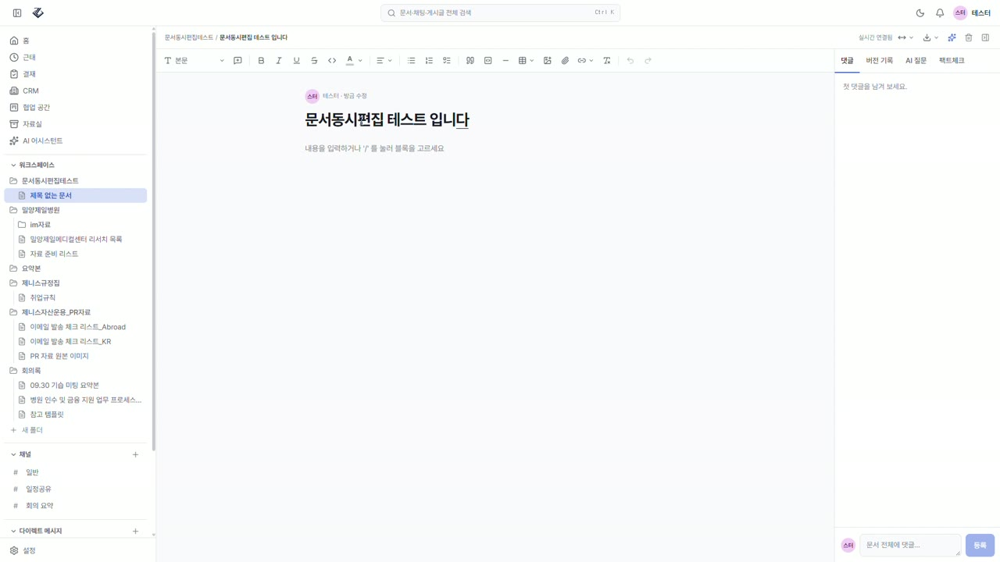

# 제니스(Zenith) — 사내 협업툴

약 15명 규모 회사의 채팅·문서·게시판·결재·근태·AI 를 **회사 서버 안에서 도는 앱 하나**로 합친 사내 협업툴. 온프레미스, 사내망 전용.

## 개요

- **목표** — 외부 SaaS 여러 곳에 흩어진 업무 대화·문서·공지를 사내 서버 하나로 일원화하고, 사내 문서를 근거로 답하는 AI 를 붙인다. 데이터·AI 추론이 사내망 밖으로 나가지 않는다.
- **모듈** — 채팅(채널·DM) · Yjs 실시간 공동편집 문서 · 등급별 게시판 · ⌘K 통합검색 · 전자결재 · 근태 · 협업 공간 · CRM · AI 어시스턴트(사내 검색 근거 + 각주). 서버의 외부 호출은 AI 공급자(Claude API) 하나뿐이다.
- **권한은 서버가 판정한다** — 프론트의 마스킹·메뉴 숨김은 편의일 뿐, 실제 차단은 API 의 403.
- **FE↔BE 계약** — `backend/openapi.json` 을 커밋하고 최신성 테스트가 지킨다. 프론트는 거기서 타입을 생성한다.

## 🎬 시연 영상

[](
https://github.com/user-attachments/assets/061e3fc0-de8c-4282-bb3a-e2969c63801a
)

문서 공동편집 · 채팅 `/ai` 근거 각주 · 등급별 게시판 · 전자결재 흐름을 테스트 계정으로 돌린 7분 영상. 720p, 클릭하면 재생·내려받기. (Release `demo-2026-10` 자산)

## 아키텍처

FastAPI 프로세스 하나가 REST · WebSocket(채팅·알림·presence) · Yjs 릴레이(pycrdt)를 함께 담고, PostgreSQL 16(FTS + pgvector) · Redis · MinIO 를 쓴다. Caddy 가 TLS 와 정적 프론트를 맡는다. AI 는 provider 모듈 뒤의 Claude API, 임베딩은 bge-m3.

## 🧱 스택

| 영역 | 기술 |
| --- | --- |
| **FE** | React 19 · Vite · Tailwind v4 · TipTap + Yjs |
| **BE** | FastAPI · PostgreSQL 16 + pgvector · Redis · MinIO · Caddy |
| **AI** | Claude API(tool use) · bge-m3 임베딩 — 공급자 경계는 `app/ai/provider.py` |
| **앱** | Tauri 2(Win) · Capacitor 8(And/iOS, v1.1) |

## 📁 모노레포 구조

```
zenith/
├─ backend/    FastAPI · 인증(JWT) · RAG · 실시간(WS/Yjs)
├─ frontend/   React 19 프로토타입 → API 연동
├─ apps/       Tauri(Win) · Capacitor(Android/iOS) 패키징
│  └─ desktop/   Windows 데스크탑 셸 → .msi  (npm run dev / npm run build)
├─ infra/      배포·온프레미스 설정(Postgres/Redis/MinIO/Ollama)
└─ docs/       문서 인덱스 — 정본은 Notion, 여기엔 링크만 둔다
```

협업 규칙(역할 분담·브랜치·커밋·리뷰 등급)은 [`CLAUDE.md`](CLAUDE.md), 영역별 규칙은 각 디렉터리의 `CLAUDE.md`.

## 🚀 실행 — 개발 서버

데모는 MSW 목이 켜진 프론트 개발 서버로 본다. 실제 백엔드까지 띄우는 법은 [backend/README.md](backend/README.md).

터미널 두 개가 필요하다.

```powershell
cd frontend
npm install
npm run dev        # http://localhost:5173 — 앱 (MSW 목 켜짐)
```

채팅 · 문서 공동편집 릴레이(http://localhost:1234)도 함께 뜬다. 릴레이만 따로 재시작하려면
`npm run server`. 릴레이가 없으면 **채팅은 아예 동작하지 않고**, 문서 공동편집은 같은
브라우저의 탭끼리만 붙는다(다른 브라우저·다른 PC와는 동기화되지 않는다).

데스크탑 창으로 보려면 — vite(:5173)를 자동으로 띄우고 그 화면을 셸에 붙인다.
릴레이는 위와 같이 따로 켠다.

```powershell
cd apps/desktop
npm install
npm run dev
```

로그인 비밀번호는 목 계정 셋 다 `zenith1234`이고, 로그인 화면 하단 버튼으로 사원·팀장·임원을
바로 채울 수 있다. 계정 목록과 역할은 [`frontend/README.md`](frontend/README.md#목-계정) 참조.

> `VITE_DISABLE_MSW=true` 는 목을 끄고 `/api` 를 FastAPI(:8000)로 보내는 스위치다 — 백엔드를 띄운 뒤에만 켠다.

자세한 사항은 [`frontend/README.md`](frontend/README.md) · [`apps/desktop/README.md`](apps/desktop/README.md).

## 🗺 로드맵 — 2026-09-07 재수립 · **MVP 완료 2026-10-28**

> **MVP 는 끝났다(2026-10-28).** 아래 M0~M4 의 개발 항목과 AI·근태·결재가 실서버(사내 5180 · Tailscale)에서 돌고 있고,
> 마지막 게이트였던 동시편집·채팅 실측을 이날 끝냈다(§성공 기준). 남은 것은 코드가 아니라 **결정 셋**(아래 🔴)과 `.msi` 서명·`prod` 브랜치다.

단계 번호는 [Notion 프로젝트 허브](https://app.notion.com/p/3aaa47166046815a8b8bfc07c8eeeb98)의 마일스톤 보드를 따른다.
**06 · WBS·일정계획서(v1.0, 2026-07-27)의 M 번호와는 뜻이 다르다** — 거기서는 M3가 AI, M4가 마감이다.

- **M0 — 기반** · 스케폴딩 · 인증·계정·감사 로그 · 프론트 화면 세트(MSW) · CI — ✅ 완료
- **M1 — 코어** · 문서 트리·CRUD·버전·댓글, `/api/yjs` 공동편집 영속화, 홈·할 일·알림함 — ✅ 완료. 게이트 **동시편집 반영 실측** 2026-10-28 통과(편집 P95 7.1ms·커서 P95 2.0ms, 기준 1초)
- **M2 — 커뮤니케이션** · `/api/ws` 채팅·알림·presence, 채팅 REST·첨부(MinIO), 멘션 알림, ⌘K 통합검색(FTS + 권한 SQL) — ✅ 완료. 게이트 **채팅 전달 P95 실측** 2026-10-28 통과(15.4ms)
- **M3 — 게시판·앱** · 등급별 게시판(마스킹·403) ✅ / **`.msi` 서명은 미착수.** Capacitor Android·iOS 는 v1.1 로 미뤘다(2026-09-22)
- **M4 — 마감** · caddy(TLS·리버스 프록시·정적 web) · 일일 `pg_dump` 백업 · `/metrics` · CSP 실적용 ✅ / **prod 브랜치·파일럿이 남았다**
- **AI · 근태 · 전자결재** · 2026-09-22 보류 해제, 2026-10 초 백엔드 구현 완료(결재함·근태·AI 어시스턴트·협업 공간·CRM) — ✅ 실서버 가동 중(2026-10-15 배포 이후). 근태·결재의 **정책**(아래 🔴 2·3)은 아직 결정 대기

> 🔴 **기간은 다시 잡지 않았다.** 8주 계획(2026-08-03 ~ 09-25)은 무효다.
>
> 남은 일에 날짜를 붙이기 전에 아래 셋이 닫혀야 한다. 셋 다 개발이 아니라 **결정**이다.
>
> 1. ~~**AI 공급자**~~ — **2026-09-22 에 정했다.** 성공 기준을 「문서·채팅·게시판·근태·결재는 사내,
>    서버의 외부 호출은 AI 공급자 하나」로 재정의하고, 민감 문서(임원 게시판·결재·근태)는 AI 색인에서 뺀다.
>    RAG 일정을 막던 건 풀렸고, 08 사업계획의 "외부 전송 0건" 약속과 어긋나는 부분에 대한
>    **경영진 사후 승인**만 남았다 ([01 · PRD](https://app.notion.com/p/3aaa471660468150a9cce9277a579deb) O10)
> 2. **근태 설계서 v0.4** — 정책 확정·노무 검토 대기
>    ([10 · 근태 모듈 설계서](https://app.notion.com/p/3aea471660468172aea1c46d2b11addf))
> 3. **A(오픈 범위 축소) / B(8주 → 14~16주) / C(인력 추가)** — 2026-08-31 제기, 아직 미결
>    ([13 · 전자결재 모듈 설계서](https://app.notion.com/p/3cda471660468170b325d0ea56562418) §12)

## ✅ 성공 기준

여기는 요약이다. **판정 근거는 [01 · PRD §5](https://app.notion.com/p/3aaa471660468150a9cce9277a579deb)** —
기준마다 07 테스트계획서의 시나리오 번호와 현재 상태가 붙어 있다.

- [x] 2인 동시편집 시 1초 이내 변경·커서 반영 (충돌 0) — **2026-10-28 실서버 실측**: 두 클라이언트가 `/api/yjs` 에 붙어 편집 50회·커서 50회, 편집 반영 P50 2.2ms · P95 7.1ms · 최대 16ms, 커서 P95 2.0ms, 끝난 뒤 두 문서 본문 동일(충돌 0). 사내 5180 과 Tailscale 입구 둘 다 같은 자릿수 (서버와 같은 PC 에서 잰 값이라 네트워크 지연은 LAN 1홉 분만 포함)
- [x] ⌘K가 문서·채팅 통합 검색, 권한 밖 문서 미노출 — 권한 필터가 검색 SQL 안에 있다
- [x] 채팅 전달 P95 (M2 게이트) — **2026-10-28 실서버 실측**: DM 100건을 `/api/ws` 로 보내 상대 소켓이 받기까지 P50 7.9ms · P95 15.4ms · 최대 54ms(사내 5180), Tailscale 입구 P95 10.8ms
- [x] AI 답변 사실문장에 각주, 권한 밖 문서는 근거 자동 제외 — 검색 도구 + 각주(backend/README 42·46), 근거는 폴더 열람 권한(57)과 `ai_source`(43) 안에서만
- [x] 임원 게시판 글 member에서 제목 마스킹 + 본문 API 403
- [x] 문서·채팅·게시판·근태·결재 데이터는 사내망 유지 — 서버의 외부 호출은 AI 공급자 하나뿐(`app/ai/provider.py` 경계, 프론트 CDN 0)
      (예외 하나: 팩트체커의 「웹도 찾기」를 켜면 검사 대상 글과 그 검사에 쓰인 규정·사내 검색 결과가 Anthropic 웹 검색의 검색어 재료가 된다 — 배포 스위치 `AI_WEB_SEARCH` 기본 꺼짐, 요청별 명시, 감사 `ai.web_search`. backend/README 49)
      (2026-09-22 재정의. 종전 문구는 "외부 API 호출 0건"이었고 Claude API 전환 뒤 자동 실패 상태였다)
- [x] AI 색인에서 임원 게시판·결재·근태 문서 제외 — 색인(`doc_chunks`·검색 도구)은 `ai_source` 문서와 **일반** 게시글만(backend/README 42·45). 단 결재·근태는 색인 대신 **열람 도구(56)가 질문자 권한대로 읽어 Claude 에 보낸다**(2026-10-15 사용자 결정) — 「본문이 외부로 나가지 않음」 문구는 PRD §5 에서 다시 적어야 한다
- [ ] Windows/.msi 사내 설치 + 모바일은 브라우저로 같은 기능 (Android APK·iOS TestFlight 는 v1.1로 미룸)
- [x] 휴가·연차가 신청·승인으로 관리되고 개인·팀 월별 근태가 집계됨 — 출퇴근 시각·생체정보·위치정보는 수집하지 않음 (구현 2026-10-02, 실서버 가동. 연차 기준·결근 정책은 🔴 2 결정 대기)
- [x] 기안 → 결재선 → 승인/반려가 한 결재함에서 처리되고, 처리 이력이 문서마다 남음 (휴가·연장근로도 같은 결재함) — 구현 2026-10-02(backend/README 73)
- [x] 결재 문서는 기안자·결재선·참조자·임원만 열람 — 역할이 아니라 관계로 판정 (기안자·결재선·참조자·대결자·exec, backend/README 73)

> 등급은 **사원(member)·임원(exec) 2단**이다(2026-09-22). 조직도에 팀장 직급이 없어 lead 계정을
> 만들 수 없었다. 팀장↑ 게시판과 팀 단위 근태 열람은 v1 에서 빠진다.

## 📚 프로젝트 문서

기획·설계 문서는 [Notion 프로젝트 허브](https://app.notion.com/p/3aaa47166046815a8b8bfc07c8eeeb98)에서 관리한다.
(01 PRD → 02 요구사항정의서 → 03 ERD·DB → 04 API 명세 → 05 화면정의서 → 06 WBS → 07 테스트계획 → 08 사업계획 → 09 기안서 → 10 근태 모듈 설계서 → 11 인증·IdP 연동 → 12 UI 청사진 → 13 전자결재 모듈 설계서 · ARCHITECTURE)

**저장소에는 문서 사본을 두지 않는다.** 뒤처진 사본은 없는 것보다 나쁘기 때문이다.
어떤 문서를 언제 열어야 하는지는 [`docs/README.md`](docs/README.md) 인덱스에 적어 뒀다.
