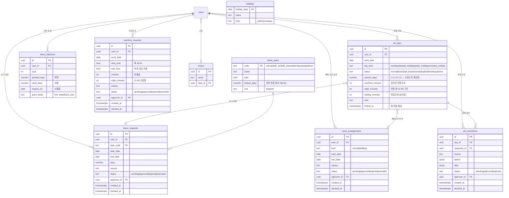

# 🕘 10 · 근태 모듈 설계서

| 항목 | 내용 |
| --- | --- |
| 문서 버전 | **v0.3** (2026-08-28) |
| 상태 | 초안 — 정책 확정·노무 검토 대기 |
| 근거 문서 | 01-PRD §4, 02-요구사항정의서, 03-ERD·DB, 04-API 명세서, ARCHITECTURE |
| 작성 배경 | 근태 관리는 PRD의 **범위 In**에만 한 줄로 존재하고, 제품범위표·FR 목록·ERD·API·화면정의·로드맵(M1~M4) 어디에도 반영돼 있지 않다. 본 문서가 그 공백을 채운다. |
| v0.3 변경 | **출퇴근 시각을 기록하지 않기로 결정.** 출입문 지문 단말을 연동하지 않고(P2), 앱 출퇴근 버튼도 두지 않는다(P3). 모든 직원이 **주 5일 09:00~18:00 고정 근무**라는 전제(P4) 위에서, 근태는 **예외(휴가·재택·외근·출장·연장)만 신청·승인으로 기록**하는 모듈이 된다. 수집 계층·어댑터·판정 엔진·홈 출퇴근 위젯을 전부 삭제하고 §1·§2·§4·§5·§6·§9·§10·§11·§12를 재작성. 삭제된 v0.2 설계는 부록 C에 요약해 남긴다. |

> ⚠️ **법률 자문 아님** — 본 문서의 근로기준법 해석은 설계 기준을 세우기 위한 정리이며, 시행 전 노무사 검토가 필요하다. 특히 §5의 산정 규칙과 §1.4의 리스크 평가는 회사의 근로계약서·취업규칙과 대조해 확정해야 한다.

---

## 1. 전제와 설계 방향

### 1.1 결정된 전제

| # | 전제 | 출처 |
| --- | --- | --- |
| P1 | 기능 깊이는 **연차·휴가 관리와 예외 근무 기록** 수준. 실근로시간 측정은 하지 않는다 | 기획 결정 (2026-08-28) |
| P2 | **출입문 지문 단말을 연동하지 않는다.** 단말이 입장 전용이고 동반 입장 시 누락이 발생해 출근 시각의 원천으로 쓸 수 없다고 판단 | 기획 결정 (2026-08-28) |
| P3 | **출퇴근 시각을 기록하지 않는다.** 앱 출퇴근 버튼도 두지 않는다 | 기획 결정 (2026-08-28) |
| P4 | **모든 사용자가 주 5일(월~금) 09:00~18:00 근무**한다. 휴게 12:00~13:00 1시간, 소정근로 1일 8시간·주 40시간. 시차·유연근무·교대는 없다 | 기획 결정 (2026-08-28) |
| P5 | 15명 규모 · 온프레미스 · 외부 API 호출 0건 | PRD §6, NFR-01 |
| P6 | 전자결재·워크플로는 v1 범위 밖 → 승인이 필요한 근태 행위는 **2단계 경량 승인**으로 갈음 | PRD §2 비목표 |

### 1.2 핵심 설계 방향 — 기본값은 정상 근무, 기록하는 것은 예외뿐

P3·P4에서 설계 전체가 따라 나온다. 출퇴근 시각이 없고 근무 형태가 하나로 고정되면, **평일의 기본 상태는 "정상 근무 8시간"이라는 상수**다. 시스템이 계산할 것이 없다. 남는 일은 그 상수에서 벗어나는 날을 붙잡는 것뿐이다.

```
[근무 달력]  평일 − 공휴일·회사휴일 = 근무일 (전 직원 공통)
                     │
                     ▼
[예외 신청]  휴가 · 재택 · 외근 · 출장 · 연장근로   ← 사람이 신청
                     │  팀장 1단계 승인
                     ▼
[일별 상태]  att_days — 근무일마다 1행. 기본 normal, 승인된 예외가 덮어씀
                     ▼
[집계]      월 근태표 · 연차 잔여 · 연장근로 누계 · CSV 리포트
```

v0.2가 "두 원천의 이벤트를 수집해 판정하는 4계층"이었다면, v0.3은 **신청과 승인 하나**다. 원본 이벤트가 없으므로 수집 계층(`att_raw_events`)도, 재계산(replay)도, 이상탐지 플래그도 필요 없다. 판정 규칙이 바뀔 여지가 사실상 없기 때문이다.

**`att_days`를 그래도 두는 이유** — 승인된 신청만으로도 상태를 매번 조인해 구할 수는 있다. 그러나 월 마감 시점의 상태를 고정해 두어야 나중에 신청이 취소·수정돼도 마감된 달의 근태표가 바뀌지 않는다. 근태 기록은 3년 보존 대상이고(§5.5), 보존의 의미는 "그때 그렇게 확정했다"는 사실이 남는 것이다.

### 1.3 이 설계가 하지 않는 것

명시적으로 범위 밖이다. 나중에 "왜 없지"가 나오지 않도록 여기에 적어 둔다.

| 하지 않는 것 | 이유 |
| --- | --- |
| 출근·퇴근 시각 기록 | P3 |
| 실근로시간·재실시간 산정 | 시각이 없으므로 불가능 |
| 지각·조퇴 판정 | 시각이 없으므로 불가능. 근태가 아닌 관리자 재량 영역으로 넘긴다 |
| 출입문 단말·CSV 임포트 연동 | P2 |
| 야간근로(22~06) 자동 산정 | 연장근로 신청서에 시간대를 적으면 그것만 집계한다(§5.3) |
| 생체정보 처리 | 단말을 연동하지 않으므로 애초에 접점이 없다(§8) |
| 급여·가산수당 계산 | 집계만 넘긴다 (I6) |

### 1.4 정직한 한계 — 주 52시간을 "관리"하지 못한다

**실근로시간을 측정하지 않으면 주 52시간 상한을 실효적으로 관리할 수 없다.** 이 설계가 집계하는 주간 근로시간은 다음 식으로 나오는 **명목값**이다.

```
주간 근로시간 = 40시간 − (휴가로 빠진 일수 × 8) + 승인된 연장근로 시간
```

여기서 실제 근무와 어긋나는 경우는 둘이다.

1. **신고 없이 늦게까지 일하는 경우** — 시스템에는 40시간으로 남는다. 실제로 60시간을 일해도 기록상 위반이 없다.
2. **일찍 퇴근하는 경우** — 시스템에는 여전히 40시간으로 남는다. 이쪽은 회사에 불리하지 않으므로 문제 제기가 없겠지만, 기록의 정확성이라는 관점에서는 같은 종류의 오차다.

근로기준법 §53의 상한은 **실근로시간** 기준이다. 명목값만으로는 위반 여부를 판정할 수 없고, 분쟁이 발생하면 회사가 "근로시간을 기록하지 않았다"는 위치에 서게 된다. 근기법 §42의 보존 의무 대상인 "근로시간 관련 서류"를 어디까지로 볼지도 노무사 확인이 필요하다 → 오픈이슈 **I13**.

> 이 한계는 설계로 해소할 수 없다. **P3(시각 미기록)을 택한 결과**이며, 그 판단이 회사의 몫이라는 것을 문서에 남기는 것이 설계자가 할 수 있는 전부다. 연장근로 신청·승인(FR-ATT-24)이 유일한 실측 통로이므로, 그 준수율이 곧 이 모듈의 법적 방어력이다.

정확도를 올리고 싶다면 선택지는 둘뿐이고, 둘 다 P3을 되돌리는 일이다 → **I11**.

- 앱 출퇴근 버튼 재도입 (자기신고 기반, 개발 2일)
- 출입 단말 연동 재도입 (출근 시각만, 장비 확인 선행)

---

## 2. 기능 요구사항 (FR-ATT)

기존 02-요구사항정의서의 표기 규칙을 따른다. 우선순위 M(필수) · S(중요) · C(선택).

> v0.2의 FR-ATT-01~09(수집·연동·앱 체크)는 **전부 폐기**한다. 번호는 재사용하지 않는다.

### 2.1 근무 달력

| ID | 요구사항 | 우선순위 | 수용 기준 |
| --- | --- | --- | --- |
| FR-ATT-10 | 근무 달력 생성 — 평일에서 공휴일·회사 지정 휴일을 제외해 근무일을 확정 | M | 연초에 1년치 생성, 공휴일 변경 시 재생성 가능 |
| FR-ATT-11 | 공휴일·회사 휴일 관리 (exec) | M | 추가·수정 시 해당 일자 이후 근태표에 즉시 반영 |
| FR-ATT-12 | 근무일마다 `att_days` 행 자동 생성 (기본 `normal`) | M | 근무일에 행이 없는 날 0건 |

### 2.2 조회·집계

| ID | 요구사항 | 우선순위 | 수용 기준 |
| --- | --- | --- | --- |
| FR-ATT-13 | 내 근태 — 월 캘린더(일별 상태) + 월 집계 | M | 화면 SCR-ATT-01 |
| FR-ATT-14 | 팀 근태 현황(lead 이상) — 팀원 × 일자 상태 그리드 | M | 본인 팀만 조회, 타 팀 403 |
| FR-ATT-15 | 월 마감 및 관리자 리포트 CSV 내보내기 | M | 마감 후 해당 월 데이터 잠금(재개방 시 이력) |
| FR-ATT-16 | 근태 상태 구분: 정상·휴가·반차·재택·외근·출장·휴일·결근 | M | 상태별 색상·범례가 캘린더와 그리드에서 동일 |

### 2.3 휴가·연차

| ID | 요구사항 | 우선순위 | 수용 기준 |
| --- | --- | --- | --- |
| FR-ATT-20 | 휴가 신청 — 종류·기간(일/반차) → 팀장 승인 | M | 승인 시 해당 일자 `att_days` 자동 반영 |
| FR-ATT-21 | 연차 자동 산정 (입사일 기준 / 회계연도 기준 택1) | M | §5.4 규칙표와 일치, 3년 이상 가산 포함 |
| FR-ATT-22 | 연차 잔여일수 조회 (부여·사용·잔여·소멸예정) | M | 신청 시 잔여 초과 차단 |
| FR-ATT-23 | 연차 사용촉진 대상자 목록 (미사용 잔여·소멸 예정일) | S | 소멸 D-60 / D-30 시점 목록 산출 |

### 2.4 예외 근무

| ID | 요구사항 | 우선순위 | 수용 기준 |
| --- | --- | --- | --- |
| FR-ATT-24 | **연장근로 신청** — 일자·시작/종료 시각·사유 → 팀장 승인 | M | 승인분만 집계. 야간 구간은 자동 분리(§5.3) |
| FR-ATT-25 | 재택·외근·출장 사전 등록 → 팀장 승인 | M | 승인 시 해당 일자 상태 변경, 정상 근무로 집계 |
| FR-ATT-26 | 근태 정정 신청 (사유 필수) → 팀장 승인 | S | 승인 전후 값이 모두 이력에 남음 |
| FR-ATT-27 | 승인 요청·결과 알림 (기존 `notifications` 재사용) | M | `kind`에 `attendance` 계열 추가 |
| FR-ATT-28 | 근태 기록 **3년 보존** 및 보존기간 내 삭제 차단 | M | 마감된 기록은 hard delete 불가, 감사 로그 남김 |

### 2.5 비기능 (기존 NFR 연장)

| ID | 분류 | 요구사항 | 기준 |
| --- | --- | --- | --- |
| NFR-ATT-01 | 보안 | 타인 근태 조회는 lead(팀 한정)·exec만. member는 본인만 | API 레벨 검사, TC-ATT-SEC |
| NFR-ATT-02 | 데이터 | 근태 기록 3년 보존 (근기법 §42) | 백업 보존 정책에 포함 |
| NFR-ATT-03 | 정확성 | 승인된 신청과 `att_days` 상태가 항상 일치 | 정합성 검증 배치 (일 1회) |
| NFR-ATT-04 | 성능 | 15명 × 1년 근태표 조회 ≤ 1초 | 월 캘린더·팀 그리드 응답 시간 |

> v0.2의 NFR-ATT-01(생체정보 미저장)·NFR-ATT-03(연동 계정 최소권한)·NFR-ATT-05(재계산 멱등성)은 **연동이 사라져 해당 사항이 없다.** 번호를 당겨 재부여했다.

---

## 3. 사용자·권한

| 역할 | 근태 권한 |
| --- | --- |
| member | 본인 근태 조회, 휴가·재택·외근·출장·연장·정정 신청, 본인 연차 잔여 조회 |
| lead | + 소속 팀원 근태 조회, 신청 **승인/반려** |
| exec | + 전사 근태 조회, 월 마감, CSV 내보내기, 연차 정책·공휴일 설정 |

> ⚠️ 기존 `users` 테이블에는 **팀(부서) 개념이 없다**(03-ERD). lead의 "소속 팀원" 판정이 불가능하므로 `teams` / `users.team_id` 추가가 선행돼야 한다 → §13 오픈이슈 **I1**.

---

## 4. 데이터 모델

### 4.1 ERD



### 4.2 설계 결정

**4.2.1 `work_policies` 테이블을 두지 않는다** — P4에서 근무 형태가 하나로 고정됐다. 시업 09:00·종업 18:00·휴게 60분·주 5일은 전 직원 공통 상수이므로 애플리케이션 설정(`ATT_WORK_START` 등)으로 충분하다. 근무제가 여러 개가 되는 순간 테이블이 필요해지지만, 지금 만들면 행이 하나뿐인 테이블을 모든 조회에 조인하게 된다 → 필요해질 때 추가한다(I7).

**4.2.2 `att_days`는 근무일에만 만든다** — 주말·공휴일은 행을 만들지 않는다. v0.2에서는 "기록 없음"과 "계산 안 함"을 구분해야 해서 전 일자를 미리 만들었지만, 이제 근무일 여부는 달력만 보면 결정론적으로 나온다. 휴일근로가 승인되면 그날만 `day_kind ≠ workday`인 행을 예외적으로 생성한다.

**4.2.3 `worked_days`를 분(分)이 아니라 일(日)로 든다** — 소정근로가 상수 8시간이므로 분 단위로 들 이유가 없다. 반차는 0.5, 결근은 0이다. 실근로시간을 측정하지 않는다는 사실이 스키마에 드러나는 편이, 나중에 이 컬럼을 근로시간 근거로 오해하는 것보다 낫다.

**4.2.4 연장근로만 분(分) 단위다** — 유일하게 실측(자기신고)되는 값이고 가산수당 근거이기 때문이다. `night_minutes`는 신청 구간과 [22:00, 익일 06:00]의 교집합으로 **신청 승인 시 1회 계산해 고정**한다. 조회할 때마다 재계산하면 승인 시점의 판단과 어긋날 수 있다.

**4.2.5 연차 잔여를 컬럼으로 들지 않는다** — `leave_balances.used_days`는 승인된 `leave_requests` 합계의 캐시이며, 신청 시점 검증은 실시간 집계로 한다. 15명 규모에서 성능 문제가 없고, 캐시 불일치가 잔여일수 오류로 이어지는 게 더 비싸다.

**4.2.6 인덱스**

```sql
CREATE UNIQUE INDEX uq_att_days        ON att_days(user_id, work_date);
CREATE INDEX idx_att_days_date         ON att_days(work_date, status);
CREATE INDEX idx_leave_req_user        ON leave_requests(user_id, start_date DESC);
CREATE INDEX idx_leave_req_pending     ON leave_requests(status, created_at) WHERE status = 'pending';
CREATE INDEX idx_arrangements_user     ON work_arrangements(user_id, start_date DESC);
CREATE INDEX idx_arrangements_pending  ON work_arrangements(status, created_at) WHERE status = 'pending';
CREATE INDEX idx_overtime_user_date    ON overtime_requests(user_id, work_date DESC);
CREATE INDEX idx_overtime_pending      ON overtime_requests(status, created_at) WHERE status = 'pending';
CREATE INDEX idx_corrections_pending   ON att_corrections(status, created_at) WHERE status = 'pending';
```

**4.2.7 시간대** — `work_date`는 `date`(KST 기준), 신청 이력의 `created_at`·`decided_at`은 `timestamptz`(UTC 저장, Asia/Seoul 표시). 연장근로의 `start_time`·`end_time`은 `time`이며 `end_time < start_time`이면 자정을 넘긴 것으로 해석한다(§5.3).

---

## 5. 산정 규칙 (근로기준법 기준)

15명 규모 = **5인 이상 사업장**이므로 연장·야간·휴일 가산수당(§56), 연차(§60) 규정이 전면 적용된다.

### 5.1 법정 기준 요약

| 항목 | 기준 | 근거 |
| --- | --- | --- |
| 소정근로 | 1일 8시간, 1주 40시간 | 근기법 §50 |
| 연장근로 한도 | 당사자 합의로 1주 12시간 → **주 52시간 상한** | §53 |
| 휴게 | 4시간 근무 시 30분 이상, 8시간 근무 시 1시간 이상 | §54 |
| 주휴일 | 1주 소정근로일 개근 시 유급휴일 1일 | §55 |
| 야간근로 | **22:00 ~ 익일 06:00** | §56 |
| 가산수당 | 연장 +50% · 야간 +50% · 휴일 8h이내 +50% / 8h초과 +100% (중복 가산 가능) | §56 |
| 연차 | §5.4 참조 | §60 |
| 기록 보존 | 3년 | §42 |

> 휴게 1시간은 12:00~13:00으로 고정돼 있고(P4) 실제 휴게시간을 측정하지 않으므로, 근무시간 산정에서 별도로 공제하지 않는다. **소정근로 8시간이 이미 휴게를 제외한 값**이다.

### 5.2 근무일 상태 판정

출퇴근 시각이 없으므로 판정할 것은 상태뿐이다. 위에서부터 먼저 맞는 규칙으로 확정한다.

| 순위 | 조건 | status | `worked_days` |
| --- | --- | --- | --- |
| 1 | 승인된 종일 휴가 존재 | `leave` | 0 (유급휴가는 출근율 산정 시 출근 간주) |
| 2 | 승인된 반차 존재 | `half_leave` | 0.5 |
| 3 | 승인된 재택/외근/출장 등록 존재 | `remote` / `field` / `trip` | 1.0 |
| 4 | `day_kind ≠ workday` | `holiday` | 0 (휴일근로 승인분은 `holiday_minutes`) |
| 5 | 관리자가 결근으로 확정 | `absent` | 0 |
| 6 | 그 외 | `normal` | 1.0 |

**`absent`(결근)는 자동 판정하지 않는다.** 무단결근은 팀장이 인지해 관리자가 수동 확정하는 경로만 둔다. 시스템에는 결근을 판별할 신호가 아예 없으므로(출근 기록이 없기 때문) 자동 판정은 원리적으로 불가능하다.

> v0.2의 `unknown`·`incomplete`·`late`·`early_leave` 상태는 **모두 삭제**한다. 출퇴근 시각이 없으면 성립하지 않는다.

### 5.3 연장·야간·휴일근로

전부 **승인된 신청분만** 집계한다. 실측이 아니라 자기신고임을 화면과 리포트에 명시한다.

**연장(overtime)** — 신청 구간의 분(分). 소정 종업시각(18:00) 이후 구간만 인정한다.

```
minutes = end_time - start_time          # end < start 이면 +24h (자정 넘김)
          단, start_time < 18:00 이면 18:00부터 계산
```

**야간(night)** — 신청 구간 ∩ [22:00, 익일 06:00]의 분. 승인 시 1회 계산해 `night_minutes`에 고정한다(4.2.4).

**휴일(holiday)** — `day_kind ≠ workday`인 날의 승인된 근무. 8시간 이내/초과로 나눠 각각 집계한다.

**주간 명목 근로시간** — §1.4의 한계를 전제로 다음과 같이 산출한다.

```
주간 소정 = Σ(worked_days) × 8시간
주간 연장 = Σ(승인된 overtime_minutes)
주간 명목 = 주간 소정 + 주간 연장
```

주 52시간 대비 표시는 **"신고 기준"이라는 라벨과 함께** 노출한다. 라벨 없이 게이지만 보여주면 실측값으로 오해된다.

> 야간·휴일 시간은 **집계·표시만** 한다. MOA는 급여를 계산하지 않는다 → 오픈이슈 **I6**.

### 5.4 연차 산정 (§60)

| 근속 | 부여 | 비고 |
| --- | --- | --- |
| 입사 1년 미만 | 1개월 개근 시 1일 (최대 11일) | 월 단위 발생 |
| 1년 이상, 출근율 80% 이상 | 15일 | |
| 1년 이상, 출근율 80% 미만 | 1개월 개근 시 1일 | |
| 3년 이상 계속근로 | 15일 + 매 2년마다 1일 가산 | **한도 25일** |

가산 계산: `granted = min(25, 15 + floor((근속연수 - 1) / 2))` (근속 3년차부터 16일)

**출근율** = (근무일 − 결근일) / 근무일. 유급휴가·재택·외근·출장은 출근으로 본다. 결근이 수동 확정 항목이므로(§5.2) 출근율은 사실상 관리자가 결근을 입력하지 않는 한 100%다 → 오픈이슈 **I14**.

부여 기준일은 **입사일 기준**과 **회계연도(1/1) 일괄 기준** 중 회사 정책을 따른다 → 오픈이슈 **I5**. `leave_balances.grant_basis`로 둘 다 수용한다.

### 5.5 보존과 마감

월 마감(`locked_at`) 시점의 `att_days`가 확정 기록이다. 마감 후에는 신청·정정이 불가하며, 수정하려면 exec가 마감을 해제해야 하고 해제 이력이 감사 로그에 남는다. 마감된 기록은 3년간 hard delete 할 수 없다(FR-ATT-28).

---

## 6. 근무 달력

연동 어댑터가 사라진 자리에 들어오는 유일한 "입력"이다.

### 6.1 근무일 결정

```
근무일 = 평일(월~금) − 공휴일(public) − 회사 지정 휴일(company)
```

`holidays` 테이블이 원천이다. 법정공휴일은 매년 관보 확정 후 exec가 일괄 등록하고, 대체공휴일·임시공휴일은 발표 시점에 추가한다. 자동 수집은 하지 않는다 — 외부 API 호출 0건 제약(P5)이 있고, 15명 규모에서 연 1회 수기 등록이 더 싸다.

### 6.2 달력 변경의 파급

공휴일이 사후에 추가되면(임시공휴일 지정 등) 이미 생성된 `att_days`를 재생성해야 한다.

| 대상 일자 | 처리 |
| --- | --- |
| 미마감 & 예외 신청 없음 | `att_days` 행 삭제 (근무일이 아니게 됨) |
| 미마감 & 휴가 승인됨 | 휴가를 자동 취소하고 연차를 **되돌린다**. 신청자·팀장에게 알림 |
| 마감됨 | 자동 변경하지 않는다. exec가 마감을 해제해야 반영된다 |

> 임시공휴일에 이미 연차를 쓴 사람의 연차를 돌려주지 않으면 그게 곧 클레임이 된다. 자동 반환을 기본값으로 두되, 반환 사실을 반드시 알린다.

---

## 7. 신청·승인 흐름

전자결재가 v1 범위 밖이므로 **신청 → 팀장 1단계 승인**의 경량 흐름으로 고정한다. 결재선·전결 규정·병렬 합의는 없다.

```
[member]  신청 (사유 필수)
            │   notifications(kind='att_approval_request') → 팀장
            ▼
[lead]    승인 / 반려 (반려 시 사유 필수)
            │   notifications(kind='att_approval_result') → 신청자
            ▼
          att_days 반영 + 이력 보존
```

| 신청 종류 | 시점 | 승인자 | 반영 |
| --- | --- | --- | --- |
| 휴가 | 사전 (병가 등은 사후 허용) | 팀장 | `status='leave'/'half_leave'`, 연차 차감 |
| 재택·외근·출장 | 사전 | 팀장 | `status='remote'/'field'/'trip'`, 정상 근무로 집계 |
| 연장근로 | 사전 신청 / 사후 승인 | 팀장 | `overtime_minutes`·`night_minutes` 가산 |
| 근태 정정 | 사후 | 팀장 | `att_days` 갱신, before/after 이력 보존 |

**마감된 월은 신청이 불가하다.** 사후 신청의 마감 전 제출을 유도하기 위해, 월 마감 3일 전에 미제출 연장근로가 있는 사람에게 알림을 보낸다.

---

## 8. 개인정보 처리

v0.2에서 이 절의 대부분은 **지문(생체정보)** 취급 규칙이었다. P2로 단말 연동이 사라지면서 **MOA는 생체정보와 접점이 없다.** 남는 것은 일반적인 근태 정보 보호다.

| 원칙 | 적용 |
| --- | --- |
| 생체정보 | **수집·수신·저장하지 않는다.** 스키마·API·로그에 관련 필드가 존재하지 않는다 |
| 위치정보 | 수집하지 않는다. 재택·외근·출장은 신청서의 텍스트일 뿐 위치 확인을 하지 않는다 |
| 접근통제 | 타인 근태 조회는 lead(팀 한정)·exec만. member는 본인만 (NFR-ATT-01) |
| 목적 제한 | 근태·연차 산정 목적 외 사용 금지. 상시 감시 용도 불가 |
| 민감정보 | 병가 사유에 상병 정보가 들어올 수 있다. **사유는 승인자와 본인에게만** 보이고 팀 그리드·리포트에는 종류만 노출한다 |
| 보관·파기 | 근기법상 3년 보존, 경과분은 파기. 마감 데이터는 hard delete 차단 |

---

## 9. API 설계

04-API 명세서의 규약(JWT 쿠키, ISO8601 UTC, 커서 페이징)을 그대로 따른다.

> v0.2의 `POST /attendance/check-in` · `check-out` · `check-out/undo`, `/admin/attendance/sync*` · `/import*` · `/identities` · `/recompute`는 **전부 폐기**한다.

### 9.1 개인

| 메서드 | 경로 | 설명 |
| --- | --- | --- |
| GET | `/attendance/me?month=2026-08` | 월별 일자 배열 + 월 집계 `{days[], summary:{worked_days, leave_days, overtime_minutes, night_minutes}}` |
| GET | `/attendance/me/summary?from=&to=` | 기간 집계 |

### 9.2 휴가

| 메서드 | 경로 | 설명 |
| --- | --- | --- |
| GET | `/leaves/balance` | `{year, granted, used, remaining, expires_on, grant_basis}` |
| GET | `/leaves?scope=me\|team` | 휴가 목록 (team은 lead 이상) |
| POST | `/leaves` | `{type_code, start_date, end_date, reason}` → 잔여 부족 시 **422** |
| POST | `/leaves/{id}/cancel` | 승인 전 취소 (승인 후는 반려 요청) |
| GET | `/leave-types` | 휴가 종류 목록 |

### 9.3 예외 근무

| 메서드 | 경로 | 설명 |
| --- | --- | --- |
| POST | `/attendance/arrangements` | `{kind, start_date, end_date, reason}` 재택·외근·출장 |
| GET | `/attendance/arrangements?scope=me\|team` | 목록 |
| POST | `/attendance/overtime` | `{work_date, start_time, end_time, reason}` → `minutes`·`night_minutes` 서버 산출 |
| GET | `/attendance/overtime?from=&to=` | 내 연장근로 목록·누계 |
| POST | `/attendance/corrections` | `{work_date, after:{status?, note?}, reason}` → 201 |

### 9.4 승인 (lead 이상)

| 메서드 | 경로 | 설명 |
| --- | --- | --- |
| GET | `/attendance/approvals?type=leave\|arrangement\|overtime\|correction` | 대기 목록 (내 팀만) |
| POST | `/attendance/approvals/{id}/approve` | 승인 → 반영 + 알림 |
| POST | `/attendance/approvals/{id}/reject` | `{reason}` 필수 |

### 9.5 팀·리포트

| 메서드 | 경로 | 설명 |
| --- | --- | --- |
| GET | `/attendance/team?month=&team_id=` | 팀원 × 일자 상태 그리드. 타 팀 요청 **403** |
| GET | `/attendance/report?month=&format=csv` | 월 리포트 (exec) |
| POST | `/attendance/close` | `{month}` 월 마감 (exec) |
| POST | `/attendance/reopen` | `{month, reason}` 마감 해제 — 감사 로그 |

### 9.6 관리 (exec)

| 메서드 | 경로 | 설명 |
| --- | --- | --- |
| GET/POST | `/admin/holidays` | 공휴일·회사 휴일 관리 → 달력 재생성(§6.2) |
| POST | `/admin/attendance/calendar/rebuild` | `{year}` 근무 달력 재생성 |
| GET/PATCH | `/admin/leave-policy` | 연차 부여 기준 설정 |

### 9.7 알림 확장

기존 `notifications.kind`에 추가: `att_approval_request` · `att_approval_result` · `att_leave_expiring` · `att_month_closing`

---

## 10. 화면 정의 (SCR-ATT)

> v0.2의 SCR-ATT-01(홈 근태 위젯)은 **삭제**한다. 출퇴근 버튼이 없어지면 홈에 상시 노출할 근태 정보가 없다. 연차 잔여는 근태 화면과 사용자 메뉴에서 확인한다.

| 화면 ID | 화면 | 대상 | 주요 요소 |
| --- | --- | --- | --- |
| SCR-ATT-01 | 내 근태 | 전체 | 월 캘린더(상태 색상) + 월 집계 카드(근무일·휴가·연장) + 잔여 연차 + 신청 버튼 |
| SCR-ATT-02 | 휴가 신청 | 전체 | 잔여 요약, 신청 폼(종류·기간·반차), 내 휴가 목록, 소멸 예정 경고 |
| SCR-ATT-03 | 예외 근무 신청 | 전체 | 재택·외근·출장 / 연장근로 탭, 기간·시각·사유 입력 |
| SCR-ATT-04 | 팀 근태 현황 | lead+ | 팀원 × 일자 그리드, 상태 범례, 연장근로 누계 |
| SCR-ATT-05 | 승인 대기함 | lead+ | 휴가·예외근무·연장·정정 탭, 일괄 승인, 반려 사유 입력 |
| SCR-ATT-06 | 근태 관리 | exec | 월 마감, 리포트 내보내기, 결근 확정, 정합성 검증 결과 |
| SCR-ATT-07 | 근태 설정 | exec | 공휴일·회사 휴일, 휴가 종류, 연차 부여 기준 |

**모바일:** SCR-ATT-01·02·03은 하단 탭바 구조(FR-SHL-03) 안에서 동작해야 한다. SCR-ATT-04·06은 데스크톱 우선.

**상태 색상 규약** — 정상 회색 / 휴가·반차 파랑 / 재택·외근·출장 청록 / 휴일 연회색 / 결근 빨강. 캘린더·그리드·리포트에서 동일하게 쓴다.

**연장근로 표시 규약** — 주간·월간 연장 누계 옆에는 항상 **"승인 신고 기준"** 을 병기한다(§5.3). 52시간 게이지를 실측처럼 보이게 그리지 않는다.

---

## 11. 테스트 케이스 (TC-ATT)

> v0.2의 TC-ATT-01~09·16~22(시각 병합·미기록·동반입장·수집 멱등성)는 **전부 폐기**한다.

| TC ID | 시나리오 | 기대 결과 | 연결 FR |
| --- | --- | --- | --- |
| TC-ATT-01 | 2026-08 근무 달력 생성 | 평일 21일 − 광복절(8/15, 토) → 근무일 21일, `att_days` 21행 | FR-ATT-10·12 |
| TC-ATT-02 | 종일 연차 승인 | `status='leave'`, `worked_days=0`, 연차 1일 차감 | FR-ATT-20 |
| TC-ATT-03 | 오전 반차 승인 | `status='half_leave'`, `worked_days=0.5`, 연차 0.5일 차감 | FR-ATT-20 |
| TC-ATT-04 | 재택 사전 등록 승인 | `status='remote'`, `worked_days=1.0`, 연차 미차감 | FR-ATT-25 |
| TC-ATT-05 | 연장근로 18:00~21:00 승인 | `minutes=180`, `night_minutes=0` | FR-ATT-24 |
| TC-ATT-06 | 연장근로 20:00~익일 01:00 승인 | `minutes=300`, `night_minutes=180` (22–01) | FR-ATT-24 |
| TC-ATT-07 | 연장근로 17:00~20:00 신청 | 18:00부터 계산 → `minutes=120` | FR-ATT-24 §5.3 |
| TC-ATT-08 | 주 5일 정상 + 연장 12시간 승인 | 주간 명목 52시간, 화면에 "신고 기준" 라벨 노출 | FR-ATT-13 §5.3 |
| TC-ATT-09 | 임시공휴일 사후 지정 (미마감, 연차 사용일) | 휴가 자동 취소 + 연차 1일 반환 + 신청자·팀장 알림 | §6.2 |
| TC-ATT-10 | 임시공휴일 사후 지정 (마감된 달) | `att_days` 불변, exec 마감 해제 안내 | §6.2 |
| TC-ATT-11 | 입사 2년 6개월차 연차 산정 | 15일 | FR-ATT-21 |
| TC-ATT-12 | 입사 3년 1개월차 연차 산정 | 16일 | FR-ATT-21 |
| TC-ATT-13 | 근속 25년차 연차 산정 | **25일 (한도)** | FR-ATT-21 |
| TC-ATT-14 | 잔여 0.5일에 1일 연차 신청 | 422 반려 | FR-ATT-22 |
| TC-ATT-15 | 정정 승인 | `att_days` 갱신, before/after 이력 존재 | FR-ATT-26 |
| TC-ATT-16 | 마감된 월에 휴가 신청 | 409 차단 | §5.5 |
| TC-ATT-17 | 정합성 검증 배치 | 승인 신청과 `att_days` 상태 불일치 0건 | NFR-ATT-03 |
| TC-ATT-SEC-01 | member가 타인 근태 조회 | 403 | NFR-ATT-01 |
| TC-ATT-SEC-02 | lead가 타 팀 근태 조회 | 403 | NFR-ATT-01 |
| TC-ATT-SEC-03 | member가 팀 그리드에서 타인 병가 사유 조회 | 사유 미노출(종류만) | §8 |
| TC-ATT-SEC-04 | 마감 월 데이터 삭제 시도 | 차단 + 감사 로그 | FR-ATT-28 |

---

## 12. 일정 영향

**현재 8주 로드맵(M1~M4)에는 근태가 들어갈 자리가 없다.** M1 코어 3주 / M2 커뮤니케이션 2주 / M3 AI 2주 / M4 마감 2주가 모두 다른 기능으로 차 있고, 근태는 WBS에도 없다.

다만 **v0.3에서 개발량이 크게 줄었다.** 수집 계층·어댑터·판정 엔진·재계산·이상탐지·홈 위젯이 통째로 사라졌기 때문이다.

| 작업 | v0.2 추정 | **v0.3 추정** | v1 최소 |
| --- | --- | --- | --- |
| 스키마·마이그레이션, 팀(teams) 추가 | 2일 | 1.5일 | ✅ |
| 앱 체크인/아웃 + 홈 위젯 + 종료훅·알림 | 2일 | **삭제** | — |
| 판정 엔진 (§5 전체 + 재계산) | 4일 | **1일** (상태 판정·연장 산출만) | ✅ |
| 어댑터 (CSV + 실시간 1종) | 3일 | **삭제** | — |
| 근무 달력·공휴일 관리 (§6) | — | 1일 | ✅ |
| 연차 산정 (§5.4) | (판정 엔진에 포함) | 1.5일 | ✅ |
| API (§9) | 3일 | 2일 | 1.5일 |
| 화면 7종 (§10) | 5일 | 3.5일 | 3종 1.5일 |
| 승인 흐름·알림 연동 | 2일 | 2일 | 1일 |
| 테스트·법정 규칙 검증 | 3일 | 1.5일 | 1일 |
| **합계** | **약 24일** | **약 14일 (3주, 1인 기준)** | **약 7.5일** |

오른쪽 열은 "근무 달력 + 휴가·연차 + 월별 조회"만 담은 최소 버전이다. 예외 근무 신청·승인 흐름·리포트를 빼면 **7.5일**로 줄어든다.

선택지는 셋이고, 판단은 기획 몫이다.

| 안 | 내용 | 대가 |
| --- | --- | --- |
| **A. v1.1로 분리** | 9/25 전사 오픈 후 별도 스프린트 (3주) | 오픈 시점에 근태 없음. PRD "범위 In"에서 근태를 빼고 v1.1로 명시해야 함 |
| **B. 축소해 M4에 삽입** | 근무 달력 + 휴가·연차 + 월별 조회(7.5일). 예외 근무·리포트는 v1.1 | M4가 2주 → 3.5주. 전사 오픈이 10월 초로 밀림 |
| **C. 일정 연장** | 전체 8주 → 10주 | 오픈 10월 중순. 예산·경영진 승인 재보고 필요 |

**권고: B.** 근거는 둘이다.

1. **연차 관리는 오픈 시점에 있어야 값이 있다.** 휴가 신청·승인은 매일 발생하는 일이고, 없으면 직원들이 기존 방식(메신저·구두)으로 되돌아간다. 반면 연장근로 신고나 팀 그리드는 없어도 당장 업무가 막히지 않는다.
2. **최소 버전이 7.5일로 작다.** v0.2 대비 절반 이하다. 출퇴근 기록을 포기한 대가로 얻은 유일한 이득이 이 축소이므로, 그 이득을 일정에 실제로 반영하는 편이 낫다.

§4 스키마는 처음부터 예외 근무·연장까지 설계해 뒀으므로 v1.1에서 마이그레이션 비용이 들지 않는다.

> **§1.4의 한계는 일정 문제가 아니다.** B를 택하든 C를 택하든 실근로시간은 기록되지 않는다. 주 52시간 대응이 필요하다는 판단이 나오면 그건 일정 조정이 아니라 **P3을 되돌리는 결정**이다(I11).

---

## 13. 오픈 이슈

| # | 이슈 | 영향 | 필요 조치 |
| --- | --- | --- | --- |
| **I1** | `users`에 **팀·부서 개념이 없다** (03-ERD). lead의 "소속 팀원" 판정 불가 | 🔴 차단 — FR-ATT-14·승인 흐름 전체 | `teams` 테이블 + `users.team_id` 추가. 03-ERD 개정 필요 |
| **I13** | **실근로시간 미기록의 법적 리스크** (§1.4). 근기법 §42 보존 대상에 근로시간 기록이 포함되는지, 주 52시간 관리 의무를 명목값으로 갈음할 수 있는지 | 🔴 법적 — 설계 전제 자체 | **노무사 확인 필수.** 결과에 따라 P3 재검토 |
| **I5** | 연차 부여 기준 (입사일 기준 vs 회계연도 일괄) 미확정 | 🔴 차단 — §5.4 | 인사 정책 확인 |
| **I14** | **결근 확정 운영 주체·절차 미정** (§5.2). 자동 판정이 불가능해 수동 입력에 전적으로 의존 | 🟠 출근율·연차 산정에 직결 | 인사·팀장 운영 규칙 합의 |
| **I11** | **출퇴근 기록 재도입 여부** — 앱 버튼(2일) 또는 단말 연동. I13 결과에 연동 | 🟠 v1.1 판단 | I13 회신 후 결정 |
| **I4** | 취업규칙상 시업·종업 시각과 휴게시간이 P4(09~18, 12~13)와 일치하는지 | 🔴 차단 — §5 전제 | 인사 담당에게 취업규칙·근로계약서 확인 |
| **I15** | **연장근로 신청 준수율** — 신고하지 않으면 집계되지 않는다. 사후 신청 마감을 언제로 둘 것인가 | 🟠 운영 | 월 마감 3일 전 알림(§7)으로 시작하되, 3개월 후 준수율 측정 |
| **I6** | 급여 시스템 연동 여부 — MOA가 가산수당을 계산하는가, 집계만 넘기는가 | 🟡 범위 | 본 설계는 **집계만** 전제. 급여 연동은 범위 밖 |
| **I7** | 근무제가 하나뿐이라는 전제(P4)가 언제까지 유효한가 — 시차·유연근무 도입 계획 | 🟡 스키마 | 도입 시 `work_policies` 추가 필요(4.2.1) |
| **I9** | 근태 데이터를 RAG 색인 대상에 포함할 것인가 | 🟡 보안 | **권고: 제외.** 개인 근태·병가 사유가 AI 답변 근거로 인용되면 안 됨 |
| **I10** | 일정 반영 방안 A/B/C 중 선택 (§12) | 🔴 차단 — WBS 확정 불가 | 경영진·기획 결정 |

> v0.2의 I2(단말 사양)·I3(단말 NTP)·I8(생체정보 동의)·I12(사외 선클릭 통제)는 **연동을 하지 않으므로 종결**한다.

---

## 부록 A. 기존 문서 반영 현황

2026-08-28 기준. v0.2 반영 후 v0.3(출퇴근 기록 삭제) 델타를 추가 반영해야 한다.

| 문서 | v0.2까지 반영 | **v0.3 델타 (출퇴근 기록 삭제)** |
| --- | --- | --- |
| **허브** | 핵심 모듈에 근태 추가, 문서 목록에 10번 등재 | ⏳ 근태 설명을 "휴가·연차 관리"로 수정 |
| **01 · PRD** | §4 제품범위표 `근태` 행 / §5 성공 기준 7번 / §8 오픈이슈 O5·O6·O7 | ⏳ 범위표에서 출퇴근·출입단말 삭제, 성공기준 7번 재작성, O6·O7 종결 |
| **02 · 요구사항정의서** | §11 근태(ATT) 절 — FR-ATT-01~35, NFR-ATT-01~06 | ⏳ FR-ATT-01~09 삭제, 10~28로 재번호, NFR 4종으로 축소 |
| **03 · ERD·DB** | §3 근태 스키마 (`att_raw_events` 등) | ⏳ `att_raw_events`·`att_identities`·`att_sync_runs`·`work_policies` 삭제, `work_arrangements`·`overtime_requests` 추가 |
| **04 · API 명세서** | §10 근태 절 / `/me/home`에 `attendance` | ⏳ check-in/out·sync·import 계열 삭제, `/me/home`에서 `attendance` 제거 |
| **05 · 화면정의서** | SCR-ATT-01~08 / 홈 위젯 행 | ⏳ 홈 근태 위젯 삭제, SCR-ATT-01~07로 재정의 |
| **07 · 테스트계획서** | TC-ATT-01~22, TC-ATT-SEC-01~04 | ⏳ 시각·수집 관련 TC 폐기, 신규 TC-ATT-01~17 반영 |
| **ARCHITECTURE** | 구성도 출입통제 경계 / §7.6 연동 경계 | ⏳ 출입통제 연동 경계 삭제 |
| **README.md** (저장소) | 핵심 모듈·성공 기준·문서 목록 | ✅ v0.3 기준으로 수정 완료 |
| **frontend/README.md** | 근태 위젯·목 엔드포인트 | ✅ v0.3 기준으로 수정 완료 |
| **06 · WBS·일정계획서** | ⏸ 보류 — I10 미결 | — |
| **08 · 사업계획서** | ⏸ 보류 — I10 미결 | — |

## 부록 B. 참조 조문

근로기준법 §42(계약서류 보존) · §50(근로시간) · §53(연장근로 제한) · §54(휴게) · §55(휴일) · §56(연장·야간·휴일근로 가산) · §60(연차 유급휴가) · §61(연차 사용촉진)

*(조문 해석은 노무사 검토 후 확정)*

## 부록 C. v0.2에서 삭제된 설계 — 되돌릴 때를 위한 요약

I11(출퇴근 기록 재도입)이 결정되면 참조할 수 있도록 핵심만 남긴다. 상세는 git 이력의 v0.2 문서에 있다.

| 항목 | v0.2 설계 | 삭제 이유 |
| --- | --- | --- |
| 4계층 구조 | 수집(`att_raw_events`) → 정규화(`att_days`) → 판정 → 보정 | 원본 이벤트가 없어져 수집·정규화 계층이 불필요 |
| 두 원천 병합 | 출근 = `min(지문 첫 이벤트, 앱 출근 버튼)` | 두 원천 모두 삭제 (P2·P3) |
| 퇴근 원천 | 앱 퇴근 버튼이 유일. 미기록 시 `work_minutes=NULL` | P3 |
| 퇴근 취소 유예 | 5분 내 취소는 승인 불요, 초과 시 보정 신청 | 퇴근 기록 자체가 없음 |
| 연동 어댑터 | `DbPollingAdapter` / `RestApiAdapter` / `CsvImportAdapter` | P2 |
| 이상탐지 D1~D9 | 특히 D2(퇴근 미기록률)가 모듈 주력 지표 | 탐지할 이벤트가 없음 |
| 재계산(replay) | `computed_by_rule_version` 기반 규칙 변경 시 소급 재산출 | 판정 규칙이 상수화되어 변경 여지 소멸 |
| 생체정보 보호 | 지문 템플릿 미저장, payload 적재 전 제거 | 접점 소멸 (§8) |
| 홈 근태 위젯 | 퇴근 버튼(주 액션) + 주 52h 게이지 + 데스크톱 종료 훅 | 누를 버튼이 없음 (§10) |

**되돌릴 경우의 최소 경로** — 앱 출퇴근 버튼만 재도입한다면 `att_days`에 `first_in_at`·`last_out_at`·`in_source`·`out_source`를 추가하고, `status`에 `incomplete`를, 상태 판정(§5.2)에 지각·조퇴·미기록 규칙을 되살리면 된다. 수집 계층과 어댑터는 앱 버튼만으로는 필요하지 않다.
