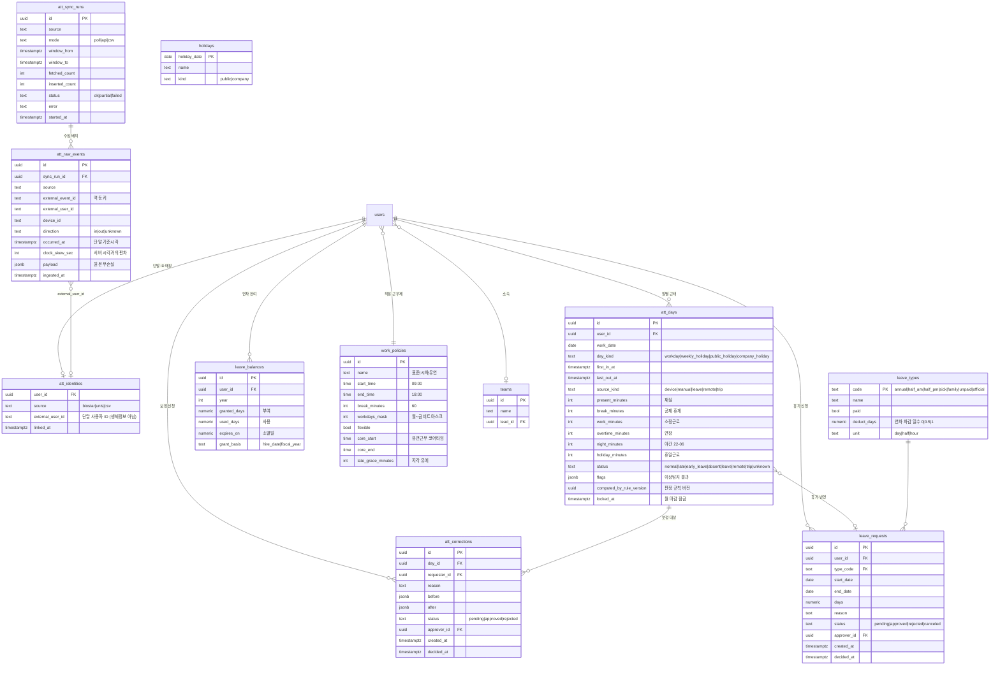

# 🕘 10 · 근태 모듈 설계서

| 항목 | 내용 |
| --- | --- |
| 문서 버전 | v0.1 초안 (2026-07-31) |
| 상태 | 초안 — 정책 확정·노무 검토 대기 |
| 근거 문서 | 01-PRD §4, 02-요구사항정의서, 03-ERD·DB, 04-API 명세서, ARCHITECTURE |
| 작성 배경 | 근태 관리는 PRD의 **범위 In**에만 한 줄로 존재하고, 제품범위표·FR 목록·ERD·API·화면정의·로드맵(M1~M4) 어디에도 반영돼 있지 않다. 본 문서가 그 공백을 채운다. |

> ⚠️ **법률 자문 아님** — 본 문서의 근로기준법 해석은 설계 기준을 세우기 위한 정리이며, 시행 전 노무사 검토가 필요하다. 특히 §5의 판정 규칙은 회사의 근로계약서·취업규칙과 대조해 확정해야 한다.

---

## 1. 전제와 설계 방향

### 1.1 결정된 전제

| # | 전제 | 출처 |
| --- | --- | --- |
| P1 | 기능 깊이는 **근로기준법 대응 수준** — 주 52시간 관리, 연차 자동 산정, 연장·야간·휴일근로 구분, 기록 보존 | 기획 결정 (2026-07-31) |
| P2 | 출퇴근 원천 데이터는 **회사 출입문 지문 단말** — 직원은 이미 출입 시 지문을 찍는다 | 기획 결정 (2026-07-31) |
| P3 | 단말 제조사·연동 규격이 **미확인** — DB 폴링 / REST API / CSV 임포트를 모두 수용하는 어댑터로 설계 | 기획 결정 (2026-07-31) |
| P4 | 15명 규모 · 온프레미스 · 외부 API 호출 0건 | PRD §6, NFR-01 |
| P5 | 전자결재·워크플로는 v1 범위 밖 → 승인이 필요한 근태 행위는 **2단계 경량 승인**으로 갈음 | PRD §2 비목표 |

### 1.2 핵심 설계 방향

출퇴근 기록의 원천이 MOA 밖에 있으므로, **MOA는 체크인 도구가 아니라 판정·집계 계층**이다. 4계층으로 나눈다.

```
[출입문 지문 단말]
      │  (어댑터: DB 폴링 / REST / CSV)
      ▼
① 수집   att_raw_events  — 원본 출입 이벤트 무손실 적재 (멱등)
      ▼
② 정규화 att_days        — 사람·날짜 단위로 접기 (첫 IN / 마지막 OUT)
      ▼
③ 판정   근무·연장·야간·휴일 분(分) 계산, 주 52h·연차 판정
      ▼
④ 보정   att_corrections / leave_requests — 사람이 고치고 팀장이 승인
```

**①을 ②·③과 분리하는 이유:** 판정 규칙(휴게 공제, 야간 기준, 지각 유예)은 취업규칙이 바뀌면 같이 바뀐다. 원본을 무손실로 남겨두면 규칙 변경 시 과거 데이터를 **재계산(replay)** 할 수 있다. 원본 위에 덮어쓰면 못 한다.

### 1.3 지문 출입기록의 구조적 한계 — 이 설계의 대부분은 여기서 나온다

| # | 한계 | 대응 |
| --- | --- | --- |
| L1 | 다수 단말이 **IN/OUT 방향을 안 준다** (그냥 "인증됨" 이벤트) | 하루 첫 이벤트=출근, 마지막=퇴근으로 추론. 방향 제공 장비면 그대로 사용 (§6.3) |
| L2 | 점심 외출·흡연·택배 수령 등 **중간 이벤트 노이즈** | 첫/마지막만 채택. 중간 이벤트는 원본에 보존하되 판정에 미사용 |
| L3 | **외근·재택·출장 시 기록이 아예 없다** → 결근으로 오판 | 기록 없는 근무일은 `미확인(unknown)`으로 두고 결근 확정하지 않음. 보정 신청으로 해소 (§7) |
| L4 | 퇴근을 안 찍고 나가면 **마지막 IN이 곧 퇴근시각**이 되어 근무시간 과소 계상 | 이상탐지 규칙 D2 (§6.4) — 당일 이벤트 1건이면 경고 플래그 |
| L5 | 단말 시계 오차 | NTP 동기화 요구 (§9 오픈이슈 I3). 수집 시 서버 시각과의 편차 로깅 |
| L6 | 지문 **원본(생체정보)** 은 개인정보보호법상 민감정보 | MOA는 생체 템플릿을 **일절 저장·수신하지 않는다**. 단말 사용자 ID만 매핑 (§8) |

> L3·L4가 핵심이다. 지문 기록만으로는 근태가 완성되지 않는다. **보정 흐름이 없으면 이 모듈은 쓸 수 없다.**

---

## 2. 기능 요구사항 (FR-ATT)

기존 02-요구사항정의서의 표기 규칙을 따른다. 우선순위 M(필수) · S(중요) · C(선택).

### 2.1 수집·연동

| ID | 요구사항 | 우선순위 | 수용 기준 |
| --- | --- | --- | --- |
| FR-ATT-01 | 출입 단말 이벤트 수집 어댑터 (DB 폴링 / REST / CSV 임포트 중 택1 구성) | M | 어댑터 교체가 설정만으로 가능, 판정 로직 무변경 |
| FR-ATT-02 | 수집 **멱등성** — 같은 이벤트 재수집 시 중복 미생성 | M | 동일 배치 2회 실행 시 `att_raw_events` 행 수 불변 |
| FR-ATT-03 | 단말 사용자 ID ↔ MOA 계정 매핑 관리 | M | 미매핑 ID 발생 시 관리자 화면에 대기열로 노출 |
| FR-ATT-04 | 주기 동기화(기본 10분) + 관리자 수동 동기화 | M | 마지막 동기화 시각·결과가 관리 화면에 표시 |
| FR-ATT-05 | 연동 실패 시 알림(관리자) 및 자동 재시도 | S | 연속 3회 실패 시 알림 1건 발송 |
| FR-ATT-06 | CSV 수동 임포트(열 매핑 UI + 미리보기 + 되돌리기) | S | 잘못 올린 배치를 배치 단위로 취소 가능 |

### 2.2 조회·집계

| ID | 요구사항 | 우선순위 | 수용 기준 |
| --- | --- | --- | --- |
| FR-ATT-10 | 내 근태 — 월 캘린더 + 일별 상세(출근/퇴근/근무·연장·야간 분) | M | 화면 SCR-ATT-02 |
| FR-ATT-11 | 홈 대시보드 근태 위젯 — 오늘 출근시각, 이번 주 누적, 주 52h 게이지 | M | 화면 SCR-ATT-01, FR-HOM 계열과 동일 카드 규격 |
| FR-ATT-12 | 팀 근태 현황(lead 이상) — 팀원 일별 상태 그리드 | M | 본인 팀만 조회, 타 팀 403 |
| FR-ATT-13 | 월 마감 및 관리자 리포트 CSV 내보내기 | M | 마감 후 해당 월 데이터 잠금(수정 시 재개방 이력 남김) |
| FR-ATT-14 | 근태 상태 구분: 정상·지각·조퇴·결근·휴가·재택·외근·출장·미확인 | M | 상태별 색상·범례가 캘린더와 그리드에서 동일 |

### 2.3 법정 판정

| ID | 요구사항 | 우선순위 | 수용 기준 |
| --- | --- | --- | --- |
| FR-ATT-20 | 근무시간 산정 — 총 재실시간에서 휴게시간 공제 | M | §5.2 규칙표와 일치 |
| FR-ATT-21 | 연장근로 산정 (1일 8시간·1주 40시간 초과분) | M | 일·주 이중 기준 중복 계상 없음 |
| FR-ATT-22 | 야간근로 산정 (22:00~06:00 구간 교집합) | M | 자정 넘김(익일 새벽 퇴근) 케이스 정확 |
| FR-ATT-23 | 휴일근로 산정 (주휴일·공휴일·회사 지정 휴일) | M | 8시간 이내/초과 구분 |
| FR-ATT-24 | **주 52시간 초과 경보** — 초과 예상 시 본인·팀장에게 사전 알림 | M | 주간 누적 45h 도달 시 1차, 52h 도달 시 2차 |
| FR-ATT-25 | 연차 자동 산정 (입사일 기준 회계연도/입사일 기준 택1) | M | §5.4 규칙표와 일치, 3년 이상 가산 포함 |
| FR-ATT-26 | 연차 사용촉진 대상자 목록 (미사용 잔여·소멸 예정일) | S | 소멸 D-60 / D-30 시점 목록 산출 |
| FR-ATT-27 | 근태 기록 **3년 보존** 및 보존기간 내 삭제 차단 | M | 마감된 기록은 hard delete 불가, 감사 로그 남김 |

### 2.4 보정·휴가

| ID | 요구사항 | 우선순위 | 수용 기준 |
| --- | --- | --- | --- |
| FR-ATT-30 | 근태 보정 신청 (사유 필수) → 팀장 승인/반려 | M | 승인 전후 값이 모두 이력에 남음 |
| FR-ATT-31 | 휴가 신청 — 종류·기간(일/반차/시간) → 팀장 승인 | M | 승인 시 해당 일자 `att_days` 자동 반영 |
| FR-ATT-32 | 연차 잔여일수 조회 (부여·사용·잔여·소멸예정) | M | 신청 시 잔여 초과 차단 |
| FR-ATT-33 | 재택·외근·출장 사전 등록 → 지문 기록 없어도 정상 처리 | M | L3 해소 |
| FR-ATT-34 | 연장근로 사전 신청·사후 승인 (가산수당 근거) | S | 승인 없는 연장은 `미승인 연장`으로 별도 집계 |
| FR-ATT-35 | 승인 요청·결과 알림 (기존 `notifications` 재사용) | M | `kind`에 `attendance` 추가 |

### 2.5 비기능 (기존 NFR 연장)

| ID | 분류 | 요구사항 | 기준 |
| --- | --- | --- | --- |
| NFR-ATT-01 | 보안 | 생체정보(지문 템플릿·이미지) MOA 저장·전송 금지 | 스키마·로그에 생체 필드 부재 검증 |
| NFR-ATT-02 | 보안 | 타인 근태 조회는 lead(팀 한정)·exec만. member는 본인만 | API 레벨 검사, TC-ATT-SEC |
| NFR-ATT-03 | 보안 | 연동 계정은 **읽기 전용** 최소권한 | 출입통제 DB에 쓰기 권한 없음 |
| NFR-ATT-04 | 데이터 | 근태 기록 3년 보존 (근기법 §42) | 백업 보존 정책에 포함 |
| NFR-ATT-05 | 정확성 | 재계산(replay) 시 동일 입력 → 동일 출력 | 멱등 재계산 테스트 |
| NFR-ATT-06 | 성능 | 15명 × 1개월 재계산 ≤ 5초 | 배치 성능 테스트 |

---

## 3. 사용자·권한

| 역할 | 근태 권한 |
| --- | --- |
| member | 본인 근태 조회, 보정·휴가·재택 신청, 본인 연차 잔여 조회 |
| lead | + 소속 팀원 근태 조회, 보정·휴가·연장 **승인/반려**, 팀 주 52h 경보 수신 |
| exec | + 전사 근태 조회, 월 마감, CSV 내보내기, 연차 정책 설정 |
| (근태관리자) | exec 중 지정. 연동 설정·수동 동기화·CSV 임포트·매핑 관리 |

> ⚠️ 기존 `users` 테이블에는 **팀(부서) 개념이 없다**(03-ERD). lead의 "소속 팀원" 판정이 불가능하므로 `teams` / `users.team_id` 추가가 선행돼야 한다 → §9 오픈이슈 **I1**.

---

## 4. 데이터 모델

### 4.1 ERD



### 4.2 설계 결정

**4.2.1 원본과 판정의 분리** — `att_raw_events`는 append-only. `att_days`는 판정 결과이므로 언제든 재생성 가능한 **파생 테이블**이다. `computed_by_rule_version`을 두어 어떤 규칙으로 계산됐는지 추적하고, 규칙 변경 시 해당 버전 이하만 재계산한다. 03-ERD의 `documents.ydoc_snapshot`(원본) ↔ `text_cache`(파생) 이중화와 같은 철학이다.

**4.2.2 멱등 키** — `UNIQUE(source, external_event_id)`. 단말이 이벤트 ID를 안 주면 `sha256(source|external_user_id|device_id|occurred_at)`로 합성한다. 폴링 구간을 겹치게 잡아도(권장: 마지막 성공 시각 −10분) 중복이 생기지 않는다.

**4.2.3 `att_days`를 매일 미리 만든다** — 근무일이면 이벤트가 없어도 `status='unknown'` 행을 생성한다. 행이 없으면 "기록 없음"과 "아직 계산 안 함"을 구분할 수 없고, 결근 누락이 조용히 지나간다.

**4.2.4 연차 잔여를 컬럼으로 들지 않는다** — `leave_balances.used_days`는 승인된 `leave_requests` 합계의 캐시이며, 신청 시점 검증은 실시간 집계로 한다. 15명 규모에서 성능 문제가 없고, 캐시 불일치가 잔여일수 오류로 이어지는 게 더 비싸다.

**4.2.5 인덱스**

```sql
CREATE UNIQUE INDEX uq_raw_events_dedupe ON att_raw_events(source, external_event_id);
CREATE INDEX idx_raw_events_user_time    ON att_raw_events(external_user_id, occurred_at);
CREATE UNIQUE INDEX uq_att_days          ON att_days(user_id, work_date);
CREATE INDEX idx_att_days_date           ON att_days(work_date, status);
CREATE INDEX idx_leave_req_user          ON leave_requests(user_id, start_date DESC);
CREATE INDEX idx_leave_req_pending       ON leave_requests(status, created_at) WHERE status = 'pending';
CREATE INDEX idx_corrections_pending     ON att_corrections(status, created_at) WHERE status = 'pending';
```

**4.2.6 시간대** — 저장은 전부 `timestamptz`(UTC), 판정은 **Asia/Seoul 기준**. `work_date`는 `date` 타입이며 KST 기준 날짜다. 자정을 넘긴 퇴근은 출근일에 귀속한다(§5.5).

---

## 5. 판정 규칙 (근로기준법 기준)

15명 규모 = **5인 이상 사업장**이므로 연장·야간·휴일 가산수당(§56), 연차(§60) 규정이 전면 적용된다.

### 5.1 법정 기준 요약

| 항목 | 기준 | 근거 |
| --- | --- | --- |
| 소정근로 | 1일 8시간, 1주 40시간 | 근기법 §50 |
| 연장근로 한도 | 당사자 합의로 1주 12시간 → **주 52시간 상한** | §53 |
| 휴게 | 4시간 근무 시 30분 이상, 8시간 근무 시 1시간 이상 | §54 |
| 주휴일 | 1주 소정근로일 개근 시 유급휴일 1일 | §55 |
| 야간근로 | **22:00 ~ 익일 06:00** | §56 |
| 가산수당 | 연장 +50% · 야간 +50% · 휴일 8h이내 +50% / 8h초과 +100% (중복 가산 가능) | §56 |
| 연차 | §5.4 참조 | §60 |
| 기록 보존 | 3년 | §42 |

### 5.2 근무시간 산정

```
present_minutes = last_out_at - first_in_at            (재실시간)
break_minutes   = 정책 휴게(work_policies.break_minutes) 또는 법정 최소치 중 큰 값
work_minutes    = present_minutes - break_minutes      (0 미만이면 0)
```

휴게 공제 규칙:

| 재실시간 | 공제 휴게 |
| --- | --- |
| 4시간 미만 | 0분 |
| 4시간 이상 ~ 8시간 미만 | 30분 |
| 8시간 이상 | max(정책값, 60분) |

> 실제 휴게시간을 지문으로 측정하지 않는다(L2). 정액 공제가 유일하게 가능한 방식이며, 이는 취업규칙상 휴게시간과 일치해야 한다 → 오픈이슈 **I4**.

### 5.3 연장·야간·휴일 산정

**연장(overtime)** — 일·주 이중 기준의 **중복 계상을 막는다.**

```
일 연장 = max(0, work_minutes - 480)
주 연장 = max(0, Σ(주간 work_minutes) - 2400)
주간 연장 확정치 = max(Σ일연장, 주연장)     ← 합산이 아니라 최댓값
```

일 8시간 초과분은 이미 주 40시간 초과분에 포함되므로 더하면 이중 계상이 된다. 주 단위 마감 시 최댓값으로 확정하고 일별 값은 참고치로 둔다.

**야간(night)** — 재실구간 ∩ [22:00, 익일 06:00]의 분(分). 자정 넘김 시 두 구간(당일 22:00~24:00, 익일 00:00~06:00)의 합.

**휴일(holiday)** — `day_kind`가 `weekly_holiday | public_holiday | company_holiday`인 날의 근무. 8시간 이내/초과로 나눠 각각 집계한다.

> 야간·휴일 시간은 **집계·표시만** 한다. MOA는 급여를 계산하지 않는다 → 오픈이슈 **I6**.

### 5.4 연차 산정 (§60)

| 근속 | 부여 | 비고 |
| --- | --- | --- |
| 입사 1년 미만 | 1개월 개근 시 1일 (최대 11일) | 월 단위 발생 |
| 1년 이상, 출근율 80% 이상 | 15일 | |
| 1년 이상, 출근율 80% 미만 | 1개월 개근 시 1일 | |
| 3년 이상 계속근로 | 15일 + 매 2년마다 1일 가산 | **한도 25일** |

가산 계산: `granted = min(25, 15 + floor((근속연수 - 1) / 2))` (근속 3년차부터 16일)

부여 기준일은 **입사일 기준**과 **회계연도(1/1) 일괄 기준** 중 회사 정책을 따른다 → 오픈이슈 **I5**. `leave_balances.grant_basis`로 둘 다 수용한다.

### 5.5 상태 판정 우선순위

위에서부터 먼저 맞는 규칙으로 확정한다.

| 순위 | 조건 | status |
| --- | --- | --- |
| 1 | 승인된 휴가 존재 | `leave` |
| 2 | 승인된 재택/외근/출장 등록 존재 | `remote` / `trip` |
| 3 | `day_kind ≠ workday` | (휴일 — 근무 있으면 휴일근로 집계) |
| 4 | 이벤트 0건 | `unknown` ← **결근으로 확정하지 않는다** |
| 5 | `first_in_at` > 시업시각 + 지각유예 | `late` |
| 6 | `last_out_at` < 종업시각 (유연근무는 코어타임 기준) | `early_leave` |
| 7 | 그 외 | `normal` |

`absent`(결근)는 **자동 판정하지 않는다.** 관리자가 `unknown` 상태를 검토해 수동 확정한다. 지문 미인식·단말 장애·연동 실패가 결근으로 둔갑하는 것이 이 모듈에서 가장 비싼 오류다.

### 5.6 자정 넘김

`first_in_at`으로부터 **24시간 이내**의 마지막 이벤트를 `last_out_at`으로 본다. 익일 03:00 퇴근은 전날 `work_date`에 귀속하고, 익일 `att_days`는 별도 생성한다. 24시간을 넘으면 퇴근 미기록으로 보고 플래그 `D2`를 세운다.

---

## 6. 연동 어댑터 설계

### 6.1 포트 인터페이스

```python
class AttendanceSourceAdapter(Protocol):
    source: str                      # "biostar" | "unis" | "csv" | ...
    def health(self) -> HealthStatus: ...
    def fetch(self, window_from: datetime, window_to: datetime) -> Iterable[RawAccessEvent]: ...

@dataclass(frozen=True)
class RawAccessEvent:
    external_event_id: str | None     # None이면 수집기가 해시로 합성
    external_user_id: str
    device_id: str | None
    direction: Literal["in", "out", "unknown"]
    occurred_at: datetime             # tz-aware
    payload: dict                     # 원본 무손실
```

판정 로직은 `RawAccessEvent`에만 의존한다. 어댑터 교체가 §5에 영향을 주지 않는 것이 이 설계의 목적이다.

### 6.2 어댑터 구현체

| 구현 | 방식 | 적용 상황 | 주의 |
| --- | --- | --- | --- |
| `DbPollingAdapter` | 출입통제 관리 SW의 DB(MSSQL/MySQL 등)를 **읽기 전용** 계정으로 SELECT | BioStar·UNIS 등 관리 SW가 사내 서버에 상주 | 벤더 스키마 변경 리스크. 뷰를 하나 만들어 그것만 조회하는 게 안전 |
| `RestApiAdapter` | 벤더 REST API 폴링 (예: BioStar 2 API) | API·라이선스 보유 시 | 인증 토큰 만료 처리 필수 |
| `CsvImportAdapter` | 관리자가 내려받은 CSV 업로드 | API·DB 접근 불가 시 최후 수단 | 열 매핑 UI 필요, 실시간성 없음 |
| `NullAdapter` | 항상 빈 결과 | 개발·테스트 | |

**어느 것도 확정되지 않은 현 시점의 개발 순서:** `CsvImportAdapter` + `NullAdapter`를 먼저 만들고 판정 로직(§5)을 완성한다. 판정은 어댑터와 무관하게 개발·테스트할 수 있다. 장비 사양이 확인되면(오픈이슈 I2) 실시간 어댑터를 붙인다.

### 6.3 방향(IN/OUT) 추론

| 단말 제공 정보 | 처리 |
| --- | --- |
| IN/OUT 구분 제공 | 첫 IN을 출근, 마지막 OUT을 퇴근 |
| 리더기별 위치(입구/출구) 제공 | 리더기 ID → 방향 매핑 테이블로 변환 |
| 구분 없음 (`unknown`) | 당일 첫 이벤트 = 출근, 마지막 = 퇴근 |

### 6.4 이상탐지 플래그

수집·판정 시 `att_days.flags`에 기록하고 관리자 화면에서 검토 대기열로 노출한다.

| 코드 | 조건 | 의미 |
| --- | --- | --- |
| D1 | 근무일인데 이벤트 0건 | 미출근 또는 재택/외근 미등록 |
| D2 | 당일 이벤트 1건뿐 | 퇴근 미기록 의심 |
| D3 | 재실시간 > 16시간 | 퇴근 미기록 또는 자정 넘김 오판 |
| D4 | 재실시간 < 1시간 | 잠깐 방문 |
| D5 | 단말 시각 편차 > 5분 | 단말 NTP 이상 |
| D6 | 미매핑 `external_user_id` | 신규 입사자 매핑 누락 |
| D7 | 동기화 연속 실패 | 연동 장애 |

---

## 7. 보정·승인 흐름

전자결재가 v1 범위 밖이므로 **신청 → 팀장 1단계 승인**의 경량 흐름으로 고정한다. 결재선·전결 규정·병렬 합의는 없다.

```
[member]  신청 (사유 필수)
            │   notifications(kind='attendance') → 팀장
            ▼
[lead]    승인 / 반려 (반려 시 사유 필수)
            │   notifications → 신청자
            ▼
          att_days 반영 + 이력 보존 (before/after)
```

| 신청 종류 | 대상 | 승인자 | 반영 |
| --- | --- | --- | --- |
| 근태 보정 | 출퇴근 시각 정정 | 팀장 | `att_days` 갱신, 원본 `att_raw_events`는 불변 |
| 휴가 | 연차·반차·병가·경조 | 팀장 | `status='leave'`, 연차 차감 |
| 재택·외근·출장 | 사전 등록 | 팀장 | `status='remote'/'trip'`, 지문 기록 없어도 정상 |
| 연장근로 | 사전 신청/사후 승인 | 팀장 | 미승인 연장은 별도 집계 |

**마감된 월(`locked_at` 설정)** 은 신청이 불가하다. 수정이 필요하면 exec가 마감을 해제해야 하며, 해제 이력이 감사 로그에 남는다.

---

## 8. 개인정보 처리 (중요)

지문은 **개인정보보호법상 민감정보(생체정보)** 다. 별도 동의와 강화된 보호조치가 필요하다.

| 원칙 | 적용 |
| --- | --- |
| 생체정보 미보관 | MOA는 지문 이미지·템플릿·특징점을 **저장하지도 수신하지도 않는다.** 어댑터는 단말 사용자 ID와 시각만 읽는다 |
| 최소수집 | `att_raw_events.payload`에 생체 관련 필드가 들어오면 **적재 전 제거**한다 (어댑터 책임) |
| 접근통제 | 타인 근태 조회는 lead(팀 한정)·exec만. member는 본인만 (NFR-ATT-02) |
| 목적 제한 | 근태 산정 목적 외 사용 금지. 위치 추적·상시 감시 용도 불가 |
| 보관·파기 | 근기법상 3년 보존, 경과분은 파기. 마감 데이터는 hard delete 차단 |
| 처리방침 고지 | 근태 수집·이용 내역을 사내 개인정보 처리방침에 반영 |

> 생체정보 자체는 기존 출입통제 시스템의 책임 영역이다. MOA는 **파생 이벤트만** 다룬다는 경계를 코드·스키마·문서에서 일관되게 유지한다.

---

## 9. API 설계

04-API 명세서의 규약(JWT 쿠키, ISO8601 UTC, 커서 페이징)을 그대로 따른다.

### 9.1 개인

| 메서드 | 경로 | 설명 |
| --- | --- | --- |
| GET | `/attendance/me/today` | 오늘 상태 `{status, first_in_at, last_out_at, work_minutes, week_total_minutes, week_limit_ratio}` |
| GET | `/attendance/me?month=2026-08` | 월별 일자 배열 + 월 집계 |
| GET | `/attendance/me/summary?from=&to=` | 기간 집계 `{work, overtime, night, holiday, leave_days}` |
| POST | `/attendance/corrections` | `{work_date, after:{first_in_at?, last_out_at?, status?}, reason}` → 201 |
| GET | `/attendance/corrections?status=pending` | 내 신청 목록 |

### 9.2 휴가

| 메서드 | 경로 | 설명 |
| --- | --- | --- |
| GET | `/leaves/balance` | `{year, granted, used, remaining, expires_on, grant_basis}` |
| GET | `/leaves?scope=me\|team` | 휴가 목록 (team은 lead 이상) |
| POST | `/leaves` | `{type_code, start_date, end_date, reason}` → 잔여 부족 시 **422** |
| POST | `/leaves/{id}/cancel` | 승인 전 취소 (승인 후는 반려 요청) |
| GET | `/leave-types` | 휴가 종류 목록 |

### 9.3 승인 (lead 이상)

| 메서드 | 경로 | 설명 |
| --- | --- | --- |
| GET | `/attendance/approvals?type=correction\|leave\|overtime` | 대기 목록 (내 팀만) |
| POST | `/attendance/approvals/{id}/approve` | 승인 → 반영 + 알림 |
| POST | `/attendance/approvals/{id}/reject` | `{reason}` 필수 |

### 9.4 팀·리포트

| 메서드 | 경로 | 설명 |
| --- | --- | --- |
| GET | `/attendance/team?date=&team_id=` | 팀원 일별 상태 그리드. 타 팀 요청 **403** |
| GET | `/attendance/alerts?week=` | 주 52h 경보 대상 목록 |
| GET | `/attendance/report?month=&format=csv` | 월 리포트 (exec) |
| POST | `/attendance/close` | `{month}` 월 마감 (exec) |
| POST | `/attendance/reopen` | `{month, reason}` 마감 해제 — 감사 로그 |

### 9.5 관리 (근태관리자)

| 메서드 | 경로 | 설명 |
| --- | --- | --- |
| POST | `/admin/attendance/sync` | 수동 동기화 `{from?, to?}` → `att_sync_runs` 생성 |
| GET | `/admin/attendance/sync-runs` | 동기화 이력·결과 |
| POST | `/admin/attendance/import` | multipart CSV 업로드 → `{batch_id, preview[]}` |
| POST | `/admin/attendance/import/{batch_id}/commit` | 임포트 확정 |
| DELETE | `/admin/attendance/import/{batch_id}` | 임포트 되돌리기 |
| GET/POST | `/admin/attendance/identities` | 단말 ID ↔ 계정 매핑 (미매핑 대기열 포함) |
| POST | `/admin/attendance/recompute` | `{from, to, user_ids?}` 판정 재계산 (규칙 변경 시) |
| GET/POST | `/admin/holidays` | 공휴일·회사 휴일 관리 |
| GET/PATCH | `/admin/work-policies` | 근무제 설정 |

### 9.6 알림 확장

기존 `notifications.kind`에 추가: `att_approval_request` · `att_approval_result` · `att_overtime_warning` · `att_sync_failed`

---

## 10. 화면 정의 (SCR-ATT)

| 화면 ID | 화면 | 대상 | 주요 요소 |
| --- | --- | --- | --- |
| SCR-ATT-01 | 홈 근태 위젯 | 전체 | 오늘 출근시각, 이번 주 누적 게이지(52h 대비), 잔여 연차, 미처리 알림 |
| SCR-ATT-02 | 내 근태 | 전체 | 월 캘린더(상태 색상) + 일별 상세 패널 + 월 집계 카드 + 보정 신청 버튼 |
| SCR-ATT-03 | 보정 신청 | 전체 | 대상 일자, 정정 전/후 비교, 사유(필수), 승인자 표시 |
| SCR-ATT-04 | 휴가 | 전체 | 잔여 요약, 신청 폼(종류·기간·반차), 내 휴가 목록, 소멸 예정 경고 |
| SCR-ATT-05 | 팀 근태 현황 | lead+ | 팀원 × 일자 그리드, 상태 범례, 이상 플래그 배지, 주 52h 경보 |
| SCR-ATT-06 | 승인 대기함 | lead+ | 보정·휴가·연장 탭, 일괄 승인, 반려 사유 입력 |
| SCR-ATT-07 | 근태 관리 | exec | 동기화 상태·이력, CSV 임포트, 매핑 대기열, 이상 검토 큐, 월 마감, 리포트 내보내기 |
| SCR-ATT-08 | 근태 설정 | exec | 근무제, 공휴일, 휴가 종류, 연차 부여 기준, 지각 유예 |

**모바일:** SCR-ATT-01·02·04는 하단 탭바 구조(FR-SHL-03) 안에서 동작해야 한다. SCR-ATT-05·07은 데스크톱 우선.

**상태 색상 규약** — 정상 회색 / 지각·조퇴 주황 / 결근 빨강 / 휴가 파랑 / 재택·외근 청록 / 미확인 점선 테두리. 캘린더·그리드·리포트에서 동일하게 쓴다.

---

## 11. 테스트 케이스 (TC-ATT)

| TC ID | 시나리오 | 기대 결과 | 연결 FR |
| --- | --- | --- | --- |
| TC-ATT-01 | 09:00 IN / 18:00 OUT | 재실 540분, 휴게 60분, 근무 480분, 연장 0 | FR-ATT-20 |
| TC-ATT-02 | 09:00 IN / 21:00 OUT | 근무 660분, 연장 180분, 야간 0 | FR-ATT-21 |
| TC-ATT-03 | 09:00 IN / 익일 02:00 OUT | 전일 귀속, 야간 240분(22–02) | FR-ATT-22 |
| TC-ATT-04 | 주 5일 각 10시간 근무 | 일연장 합 600분 vs 주연장 600분 → **중복 계상 없이 600분** | FR-ATT-21 |
| TC-ATT-05 | 주 누적 45h 도달 | 본인·팀장에게 1차 경보 발송 | FR-ATT-24 |
| TC-ATT-06 | 근무일에 이벤트 0건 | `status='unknown'` + 플래그 D1, **결근 아님** | FR-ATT-14 |
| TC-ATT-07 | 재택 사전 등록 후 이벤트 0건 | `status='remote'`, 플래그 없음 | FR-ATT-33 |
| TC-ATT-08 | 같은 배치 2회 수집 | `att_raw_events` 행 수 불변 | FR-ATT-02 |
| TC-ATT-09 | 폴링 구간 10분 중첩 | 중복 0건 | FR-ATT-02 |
| TC-ATT-10 | 입사 2년 6개월차 연차 산정 | 15일 | FR-ATT-25 |
| TC-ATT-11 | 입사 3년 1개월차 연차 산정 | 16일 | FR-ATT-25 |
| TC-ATT-12 | 근속 25년차 연차 산정 | **25일 (한도)** | FR-ATT-25 |
| TC-ATT-13 | 잔여 0.5일에 1일 연차 신청 | 422 반려 | FR-ATT-32 |
| TC-ATT-14 | 보정 승인 | `att_days` 갱신, `att_raw_events` 불변, before/after 이력 존재 | FR-ATT-30 |
| TC-ATT-15 | 판정 규칙 변경 후 재계산 | 동일 원본 → 새 규칙으로 일관 재산출 | NFR-ATT-05 |
| TC-ATT-SEC-01 | member가 타인 근태 조회 | 403 | NFR-ATT-02 |
| TC-ATT-SEC-02 | lead가 타 팀 근태 조회 | 403 | NFR-ATT-02 |
| TC-ATT-SEC-03 | 스키마·API 응답 전수 검사 | 생체정보 필드 0건 | NFR-ATT-01 |
| TC-ATT-SEC-04 | 마감 월 데이터 삭제 시도 | 차단 + 감사 로그 | FR-ATT-27 |

---

## 12. 일정 영향 — 솔직한 평가

**현재 8주 로드맵(M1~M4)에는 근태가 들어갈 자리가 없다.** M1 코어 3주 / M2 커뮤니케이션 2주 / M3 AI 2주 / M4 마감 2주가 모두 다른 기능으로 차 있고, 근태는 WBS에도 없다.

본 설계 기준 순개발량 추정:

| 작업 | 추정 |
| --- | --- |
| 스키마·마이그레이션, 팀(teams) 추가 | 2일 |
| 판정 엔진 (§5 전체 + 재계산) | 4일 |
| 어댑터 (CSV + 실시간 1종) | 3일 |
| API (§9) | 3일 |
| 화면 8종 (§10) | 5일 |
| 승인 흐름·알림 연동 | 2일 |
| 테스트·법정 규칙 검증 | 3일 |
| **합계** | **약 22일 (4~5주, 1인 기준)** |

선택지는 셋이고, 판단은 기획 몫이다.

| 안 | 내용 | 대가 |
| --- | --- | --- |
| **A. v1.1로 분리** | 9/25 전사 오픈 후 별도 스프린트 | 오픈 시점에 근태 없음. PRD "범위 In"에서 근태를 빼고 v1.1로 명시해야 함 |
| **B. 축소해 M4에 삽입** | 수집 + 조회 + CSV 리포트만. 연차·법정 판정·승인 제외 | M4가 2주 → 3.5주. 전사 오픈이 10월 초로 밀림. "근로기준법 대응"은 v1.1 |
| **C. 일정 연장** | 전체 8주 → 12주 | 오픈 10월 하순. 예산·경영진 승인 재보고 필요 |

**권고: B.** 근태는 매일 쌓이는 데이터라 늦게 시작할수록 초기 데이터가 비고, 오픈 시점에 없으면 직원들이 기존 방식으로 되돌아간다. 다만 법정 판정(연차 자동산정·주52h)까지 v1에 넣는 건 8주 안에서 무리다 — 수집·집계 기반을 먼저 깔고 판정 계층을 v1.1에 얹는 순서가 위험이 낮다. §4 스키마는 처음부터 판정 계층을 염두에 두고 만들어 두면 마이그레이션 비용이 들지 않는다.

> 이 판단은 A안(연차·법정 판정 포함)을 선택한 기획 방향과 충돌한다. "근로기준법 대응"을 8주 안에 넣으려면 C안(일정 연장)이 정직한 답이다. 축소 없이 일정도 그대로 가는 조합은 존재하지 않는다.

---

## 13. 오픈 이슈

| # | 이슈 | 영향 | 필요 조치 |
| --- | --- | --- | --- |
| **I1** | `users`에 **팀·부서 개념이 없다** (03-ERD). lead의 "소속 팀원" 판정 불가 | 🔴 차단 — FR-ATT-12·승인 흐름 전체 | `teams` 테이블 + `users.team_id` 추가. 03-ERD 개정 필요 |
| **I2** | 출입 단말 제조사·모델·관리 SW·DB 접근 가능 여부 미확인 | 🔴 차단 — 실시간 어댑터 구현 불가 | 총무/시설 담당 확인. 벤더·버전·API 라이선스·DB 계정 |
| **I3** | 단말 NTP 동기화 상태 미확인 | 🟡 정확도 | 시각 편차 실측 후 허용 오차 결정 |
| **I4** | 취업규칙상 휴게시간·시업/종업 시각·지각 유예 미확인 | 🔴 차단 — §5.2 정액 공제 기준 | 인사 담당에게 취업규칙·근로계약서 확인 |
| **I5** | 연차 부여 기준 (입사일 기준 vs 회계연도 일괄) 미확정 | 🔴 차단 — §5.4 | 인사 정책 확인 |
| **I6** | 급여 시스템 연동 여부 — MOA가 가산수당을 계산하는가, 집계만 넘기는가 | 🟡 범위 | 본 설계는 **집계만** 전제. 급여 연동은 범위 밖 |
| **I7** | 유연근무·시차출퇴근 운영 여부 | 🟡 판정 규칙 | 운영 시 코어타임 기준 필요 (§5.5 6순위) |
| **I8** | 생체정보 수집·이용 동의서가 기존 출입통제 도입 시 확보돼 있는가 | 🟠 법적 | 인사 확인. MOA는 생체정보 미보관이나 목적 확장에 해당할 수 있음 |
| **I9** | 근태 데이터를 RAG 색인 대상에 포함할 것인가 | 🟡 보안 | **권고: 제외.** 개인 근태가 AI 답변 근거로 인용되면 안 됨 |
| **I10** | 일정 반영 방안 A/B/C 중 선택 (§12) | 🔴 차단 — WBS 확정 불가 | 경영진·기획 결정 |

---

## 부록 A. 기존 문서 반영 현황

2026-07-31 기준. Notion 문서 세트 반영 완료.

| 문서 | 변경 | 상태 |
| --- | --- | --- |
| **허브** | 핵심 모듈에 근태 추가, 문서 목록에 10번 등재 | ✅ 반영 |
| **01 · PRD** | §4 제품범위표에 `근태` 행 / §5 성공 기준 7번 / §8 오픈이슈 O5(일정안)·O6(단말 미확인)·O7(취업규칙·연차 기준) / 관련 문서에 10번 | ✅ 반영 |
| **02 · 요구사항정의서** | §11 근태(ATT) 절 신설 — FR-ATT-01~35, NFR-ATT-01~06, §11.6 선행 조건 | ✅ 반영 |
| **03 · ERD·DB** | `users`에 `team_id`·`hire_date`·`work_policy_id` / §2.6 teams 선행 조건 / §3 근태 스키마(테이블 11종 ERD·원본파생 분리·멱등·생체정보 미보관·인덱스·시간대) | ✅ 반영 |
| **04 · API 명세서** | §10 근태 절 신설(개인·휴가·승인/팀/리포트·관리·알림 kind) / `/me/home` 응답에 `attendance` / 기존 §10 → §11로 이동 | ✅ 반영 |
| **05 · 화면정의서** | SCR-ATT-01~08 신설 / SCR-01 홈에 근태 위젯 행 / SCR-07 모바일 진입점 | ✅ 반영 |
| **07 · 테스트계획서** | TC-ATT-01~15, TC-ATT-SEC-01~04 / CI에 TC-ATT-SEC-03(생체정보 부재) 추가 | ✅ 반영 |
| **ARCHITECTURE** | 구성도에 출입통제 경계 추가 / §7.6 근태 연동 경계 — 어댑터 패턴, 원본·파생 분리, **NFR-01 위반 아님** 명시, 생체정보 경계, 읽기전용 계정, RAG 제외 권고 | ✅ 반영 |
| **06 · WBS·일정계획서** | §12 A/B/C 확정안에 따라 태스크·간트 갱신 | ⏸ 보류 — I10 미결 |
| **08 · 사업계획서** | 근태 도입 효과 + 일정 변경분 | ⏸ 보류 — I10 미결 |
| **README.md** (저장소) | 핵심 모듈·성공 기준·문서 목록에 근태, 로드맵 공백 경고 | ✅ 반영 |

## 부록 B. 참조 조문

근로기준법 §42(계약서류 보존) · §50(근로시간) · §53(연장근로 제한) · §54(휴게) · §55(휴일) · §56(연장·야간·휴일근로 가산) · §60(연차 유급휴가) · §61(연차 사용촉진) / 개인정보보호법 §23(민감정보 처리 제한)

*(조문 해석은 노무사 검토 후 확정)*
